# Προδιαγραφή διασύνδεσης Orithon ↔ SoftOne ERP

**Έκδοση:** 1.1 — 7 Σεπτεμβρίου 2026 · **Κατάσταση:** προς συμφωνία με τον integrator · **Συντάκτης:** ομάδα πλατφόρμας Orithon

> Το έγγραφο περιγράφει **τι** θα ανταλλάσσουν η πλατφόρμα Orithon (διαχείριση κτηρίων) και το νέο SoftOne της Orithon, **με ποια αντικείμενα και πεδία**, **πότε**, και **τι πρέπει να προετοιμάσει ο integrator** στο SoftOne. Η υλοποίηση από πλευράς Orithon ξεκινά μετά τη συμφωνία των σημείων της ενότητας 11.

---

## 1. Στόχος και πεδίο

Η Orithon λειτουργεί ως **εταιρεία διαχείρισης πολυκατοικιών** και ως **ενδιάμεσος** ανάμεσα σε πελάτες (ιδιοκτήτες/διαχειριστές κτηρίων) και συνεργάτες (συνεργεία, προμηθευτές). Η πλατφόρμα Orithon είναι το **σύστημα λειτουργίας** (βλάβες, προσφορές, συμβάσεις, κοινόχρηστα), το SoftOne είναι το **σύστημα λογιστικής/εμπορικής διαχείρισης** (συναλλασσόμενοι, συμβάσεις, παραστατικά, myDATA, εισπράξεις/πληρωμές).

Η διασύνδεση καλύπτει:

| # | Ροή | Κατεύθυνση | Φάση |
|---|---|---|---|
| 1 | Πελάτες → Πελάτες SoftOne (CUSTOMER) | Orithon → SoftOne | Α |
| 2 | Συνεργάτες/Προμηθευτές → Προμηθευτές SoftOne (SUPPLIER) | Orithon → SoftOne | Α |
| 3 | Κτήρια → Έργα SoftOne (PRJC) | Orithon → SoftOne | Α |
| 4 | Υπηρεσίες & προϊόντα → Υπηρεσίες/Είδη SoftOne (SERVICE / ITEM) | Orithon → SoftOne | Α |
| 5 | **Συμβάσεις έργου (back-to-back)** → Ειδικές συμβάσεις SoftOne (CNTR ×2) | Orithon → SoftOne | Α |
| 6 | **Συμβάσεις διαχείρισης (πακέτο υπηρεσιών ανά ακίνητο)** → Ειδική σύμβαση με περιοδική τιμολόγηση (CNTR) | Orithon → SoftOne | Α |
| 7 | Μηνιαία τιμολόγια υπηρεσιών προς πελάτες → Παραστατικά πώλησης (SALDOC) | Orithon → SoftOne | Β |
| 8 | Τιμολόγια συνεργατών προς Orithon → Παραστατικά αγοράς (PURDOC) | Orithon → SoftOne | Β |
| 9 | Εισπράξεις/πληρωμές, υπόλοιπα συναλλασσομένων | SoftOne → Orithon (ανάγνωση) | Β |
| 10 | Λίστες παραμέτρων (ΦΠΑ, μονάδες, σειρές, τύποι συμβάσεων…) | SoftOne → Orithon (ανάγνωση) | Α |

**Εκτός πεδίου:** τα **κοινόχρηστα** των κτηρίων (χρεώσεις ενοίκων/ιδιοκτητών) δεν είναι έσοδα της Orithon και **δεν** περνούν στο SoftOne. Οι **ιδιωτικές λίστες προμηθευτών** των διαχειριστών-πελατών δεν συγχρονίζονται. Το myDATA γίνεται από το SoftOne (η Orithon δεν στέλνει τίποτα στην ΑΑΔΕ).

## 2. Αρχές

1. **Master δεδομένων:** για πελάτες, συνεργάτες, κτήρια, υπηρεσίες και συμβάσεις master είναι η Orithon· το SoftOne λαμβάνει. Για παραστατικά που εκδίδει το SoftOne (αριθμός, myDATA MARK) και για υπόλοιπα, master είναι το SoftOne.
2. **Idempotency:** κάθε εγγραφή Orithon κρατά το SoftOne id (TRDR, PRJC, MTRL, CNTR, FINDOC). Πριν από κάθε εισαγωγή γίνεται αναζήτηση (ΑΦΜ για συναλλασσόμενους, CODE για τα υπόλοιπα) ώστε να μη δημιουργούνται διπλά.
3. **Μόνο official Web Services** (softone.gr/ws): `login`, `authenticate`, `getData`, `setData`, `getBrowserInfo/Data`, `getSelectorData`. Χωρίς custom JS services, εκτός αν συμφωνηθεί ρητά.
4. **Κάθε αποστολή καταγράφεται** (payload, απάντηση, σφάλμα) και είναι επαναλήψιμη· υπάρχει λειτουργία «προεπισκόπηση» (dry run) που δείχνει το JSON πριν σταλεί.
5. **Κωδικοποίηση:** οι απαντήσεις του SoftOne είναι Windows-1253 (και gzip) — αποκωδικοποίηση με `arrayBuffer` + iconv· ποτέ `res.json()`.
6. **Session:** το `clientID` του `authenticate` επαναχρησιμοποιείται όλη την ημέρα· νέο login μόνο σε `errorcode -100/-101`.

## 3. Τεχνική σύνδεση

| Στοιχείο | Τιμή / Ποιος το δίνει |
|---|---|
| Endpoint | `https://<registered-name>.oncloud.gr/s1services` — **integrator** |
| Web Account (username/password) | αποκλειστικός λογαριασμός `orithon-api` — **integrator** |
| AppID (≥ 1000, Web & Mobile → Web Services) | **integrator** |
| COMPANY / BRANCH / MODULE / REFID | **integrator** (MODULE 0 = Εμπορικό) |
| Δικαιώματα λογαριασμού | CUSTOMER, SUPPLIER, PRJC, SERVICE, ITEM, CNTR, CNTRTYPE, SALDOC, PURDOC (read/write) · SERIES, VAT, MTRUNIT, PAYMENT, COUNTRY, SOCURRENCY (read) |
| Ρυθμός κλήσεων | ≤ 60/λεπτό, batch σε ώρες εκτός αιχμής για μαζικές αρχικές φορτώσεις |
| Ασφάλεια | HTTPS μόνο· τα μυστικά αποθηκεύονται ως μεταβλητές περιβάλλοντος στον server της Orithon, ποτέ στη βάση/UI |

Ροή αυθεντικοποίησης: `login {username,password,appId}` → `authenticate {clientID, company, branch, module, refid}` → μόνιμο `clientID`.

## 4. Αντιστοίχιση οντοτήτων

### 4.1 Πελάτης → CUSTOMER (TRDR, SODTYPE 13)

| SoftOne (TRDR) | Orithon | Κανόνας |
|---|---|---|
| CODE * | `Customer.code` ή `PM-C-<αύξων>` | Σταθερός μοναδικός κωδικός· δεν αλλάζει ποτέ |
| NAME * | `Customer.name` | Επωνυμία / ονοματεπώνυμο |
| AFM | `Customer.afm` | Αν λείπει → CHKAFM = 0 |
| IRSDATA | `Customer.doy` | ΔΟΥ (κείμενο → επιλογή λίστας IRSDATA από το SoftOne) |
| ADDRESS, ZIP, CITY, DISTRICT | address, postalCode, city, district | |
| PHONE01, PHONE02, FAX, EMAIL, WEBPAGE | phone, phone2, fax, email, webpage | |
| COUNTRY *, SOCURRENCY * | παράμετροι (Ελλάδα, EUR) | ids από την εγκατάσταση |
| PAYMENT | παράμετρος (προεπιλογή) | |
| CMPMODE * | `type` INDIVIDUAL → φυσικό, COMPANY → νομικό πρόσωπο | ids από `$CMPMODE` |
| ISACTIVE * | `isActive` | |
| REMARKS | `remarks` | |
| Λοιπά required (VATSTS, KEPYOSTS, GSISMD, OPITMODE…) | — | προεπιλογές SoftOne στην εισαγωγή |

Αναζήτηση υπάρχοντος: `getBrowserInfo CUSTOMER` με φίλτρο `CUSTOMER.AFM=<ΑΦΜ>` → αν βρεθεί, δένεται το TRDR χωρίς νέα εγγραφή.

### 4.2 Συνεργάτης / Προμηθευτής → SUPPLIER (TRDR, SODTYPE 12)

Ίδια πεδία με 4.1 με κωδικό `PM-S-<αύξων>`. Επιπλέον:

| SoftOne | Orithon | Κανόνας |
|---|---|---|
| PAYMENT | `paymentTermsDays` | πίνακας αντιστοίχισης ημερών πίστωσης → PAYMENT (integrator: ποιοι τρόποι πληρωμής υπάρχουν) |
| INPAYVAT * (άρθρο 39β) | 0 | |
| Τραπεζικοί λογαριασμοί (IBAN) | `iban`, `bank` | **child table** συναλλασσομένου — ζητείται από τον integrator ο ακριβής πίνακας (π.χ. TRDBANKACC) |
| REMARKS | ειδικότητες, 24/7, ωράριο | ενημερωτικά |

### 4.3 Κτήριο → PRJC (Έργο)

| SoftOne (PRJC) | Orithon | Κανόνας |
|---|---|---|
| CODE * | `PM-B-<αύξων>` | |
| NAME * | `Building.name` — διεύθυνση, πόλη | |
| TRDR | `Property.customer.softoneTrdr` | ο πελάτης πρέπει να έχει συγχρονιστεί πρώτα |
| PRJTYPE * | παράμετρος | |
| ISACTIVE *, BLOCKED * | 1, 0 | |
| FROMDATE | ημερομηνία έναρξης διαχείρισης | |
| REMARKS | όροφοι, ανελκυστήρας, μονάδες | |

Οι συμβάσεις (CNTR) και τα παραστατικά (SALDOC/PURDOC) αναφέρουν το PRJC του κτηρίου → αναφορές κερδοφορίας ανά κτήριο στο SoftOne.

### 4.4 Υπηρεσίες → SERVICE (MTRL, SODTYPE 52) · Προϊόντα → ITEM (MTRL, SODTYPE 51)

Τρεις πηγές υπηρεσιών: (α) υπηρεσίες πακέτων διαχείρισης της Orithon, (β) κατάλογος υπηρεσιών συνεργατών (κεντρικός), (γ) υπηρεσίες/προϊόντα κάθε συνεργάτη με τιμές.

| SoftOne (MTRL) | Orithon | Κανόνας |
|---|---|---|
| CODE * | `PM-SRV-<αύξων>` / `PM-ITM-<αύξων>` | |
| NAME * | name | |
| VAT * | `vatPct` → παράμετρος «ΦΠΑ %→id» | |
| MTRUNIT1 * (ITEM: και MTRUNIT3/4, MU31/MU41 = 1) | `unit` → παράμετρος «μονάδα→id» (επίσκεψη, ώρα, τεμ., τ.μ., μήνας, εργασία) | |
| MTRTYPE * | υπηρεσία / είδος | |
| PRICEW (χονδρικής) | τιμή συνεργάτη (κόστος) | |
| PRICER (λιανικής) | τιμή πελάτη (με περιθώριο) | |
| MTRCATEGORY | κατηγορία βλάβης | προαιρετικά — SRVCATEGORY/ITECATEGORY από τον integrator |
| ISACTIVE * | active | |

**Απόφαση προς συμφωνία:** ένα MTRL ανά υπηρεσία καταλόγου (κοινό για όλους τους συνεργάτες, οι τιμές ανά συνεργάτη μένουν στην Orithon και περνούν μόνο στις γραμμές των συμβάσεων/παραστατικών) — προτεινόμενο — ή ένα MTRL ανά συνεργάτη-υπηρεσία.

### 4.5 Σύμβαση έργου → **δύο Ειδικές συμβάσεις CNTR (back-to-back)**

Κάθε επισκευή/εργασία που περνά από προσφορά συνεργάτη → αποδοχή πελάτη → παραλαβή, είναι στην Orithon μία «σύμβαση έργου» `WO-ΕΤΟΣ-ΑΑΑΑ` με **δύο τιμές**: τιμή συνεργάτη (τι πληρώνει η Orithon) και τιμή πελάτη (τι χρεώνει η Orithon). Στο SoftOne γίνεται:

| Πεδίο CNTR | **CNTR-A** (πελάτης ↔ Orithon) | **CNTR-B** (Orithon ↔ συνεργάτης) |
|---|---|---|
| CODE * | `WO-2026-0001-A` | `WO-2026-0001-B` |
| NAME * | τίτλος εργασίας | τίτλος εργασίας |
| TSODTYPE * / TRDR * | 13 / TRDR πελάτη | 12 / TRDR συνεργάτη |
| CNTRTYPE * | παράμετρος «Σύμβαση έργου — πελάτης» | παράμετρος «Σύμβαση έργου — συνεργάτης» |
| CNTRTYPE1 * | παράμετρος (χαρακτηρισμός) | ίδιο |
| CNTRS (σχετική) | — | **id της CNTR-A** ← η back-to-back σύνδεση |
| PRJC | έργο κτηρίου | έργο κτηρίου |
| BRANCH * | παράμετρος | ίδιο |
| TRNDATE * | ημερομηνία δημιουργίας | ίδιο |
| FROMDATE * | αποδοχή πελάτη (ημερομηνία/ώρα/IP στην Orithon) | αποδοχή ανάθεσης από συνεργάτη |
| TODATE | ολοκλήρωση + μήνες εγγύησης | ίδιο |
| BLCKDATE | ακύρωση/απόρριψη | ίδιο |
| CNTRVALUE / SOVALUE | καθαρή τιμή πελάτη | καθαρή τιμή συνεργάτη |
| REFCODE | `WO-2026-0001` (κοινός αριθμός) | ίδιο |
| COMMENTS / REMARKS | μήνυμα προς πελάτη / περιγραφή βλάβης | περιγραφή προσφοράς |
| VARCHAR01 | Orithon id σύμβασης (idempotency) | ίδιο |
| ISACTIVE *, BOOL01–04 * | 1, 0 | ίδιο |

**Γραμμές (CNTRLINES)** — και στις δύο συμβάσεις:

| Πεδίο | Τιμή |
|---|---|
| LINENUM * | 9000001, 9000002… |
| LINETYPE1 * | 1 (αφορά υπηρεσίες) |
| MSODTYPE * / MTRL * | 52 / MTRL της υπηρεσίας της προσφοράς (γραμμές ειδών: 51 / MTRL προϊόντος) |
| FROMDATE / TODATE | όπως η σύμβαση |
| VISITUNIT / VISITNUM | παράμετρος «μήνες» / μήνες εγγύησης (**διάρκεια**) |
| PERIODINV | 0 (εφάπαξ) |
| QTY1 *, QTY2 * | 1, 1 (ή ποσότητα υλικών) |
| PRICE * | τιμή πελάτη (Α) / τιμή συνεργάτη (Β) — καθαρή, ΦΠΑ από το MTRL |
| COMMENTS | τι περιλαμβάνει η προσφορά |
| ISACTIVE * | 1 |

Χρέωση αυτοψίας (αν υπάρχει και δεν συμψηφίζεται): επιπλέον γραμμή υπηρεσίας «Αυτοψία».

**Κύκλος ζωής:** CNTR-A δημιουργείται στην αποδοχή του πελάτη· CNTR-B στην αποδοχή ανάθεσης από τον συνεργάτη· και οι δύο ενημερώνονται με TODATE στην παραλαβή (επιβεβαίωση διαχειριστή ή σιωπηρή)· BLCKDATE + ISACTIVE 0 σε απόρριψη/ακύρωση. Το τιμολόγιο του συνεργάτη (PURDOC) και το τιμολόγιο προς τον πελάτη (SALDOC) αναφέρουν το αντίστοιχο CNTR.

### 4.6 Σύμβαση διαχείρισης (πακέτο υπηρεσιών ανά ακίνητο) → CNTR με περιοδική τιμολόγηση

| Πεδίο | Τιμή |
|---|---|
| CODE * / NAME * | `PM-MC-<κτήριο>` / «Διαχείριση — <κτήριο>» |
| TSODTYPE * / TRDR * | 13 / TRDR πελάτη |
| CNTRTYPE * | παράμετρος «Σύμβαση διαχείρισης» |
| PRJC | έργο κτηρίου |
| FROMDATE * / TODATE | έναρξη / λήξη πακέτου |
| Γραμμές: MSODTYPE 52 / MTRL υπηρεσίας πακέτου, **PERIODINV = 1 (μηνιαία)**, VISITUNIT μήνες / VISITNUM διάρκεια, QTY1 = μονάδες κτηρίου (για χρέωση ανά μονάδα) ή 1 (πάγιο), PRICE = μηνιαία τιμή | |

**Απόφαση προς συμφωνία:** τα μηνιαία τιμολόγια να τα παράγει το SoftOne από τη σύμβαση (μηχανισμός «Δημιουργία παραστατικού σύμβασης» / περιοδικής καταβολής) — **προτεινόμενο** — ή να τα δημιουργεί η Orithon ως SALDOC (ενότητα 4.7). Στη δεύτερη περίπτωση η Orithon χρειάζεται πίσω τον αριθμό παραστατικού.

### 4.7 Τιμολόγια προς πελάτες → SALDOC (Φάση Β)

FINDOC: SERIES * (παράμετρος), TRDR * (πελάτης), TRNDATE *, PRJC, CNTR, COMMENTS (περίοδος), PAYMENT. Γραμμές SRVLINES: MTRL *, VAT *, QTY1 *, PRICE, COMMENTS. Το SoftOne επιστρέφει FINDOC id + αριθμό· η Orithon αποθηκεύει το id και εμφανίζει τον αριθμό στον πελάτη.

### 4.8 Τιμολόγια συνεργατών → PURDOC (Φάση Β)

FINDOC: SERIES * (παράμετρος), TRDR * (συνεργάτης), TRNDATE *, FINCODE (αριθμός παραστατικού συνεργάτη), CNTR = CNTR-B, PRJC. Γραμμές SRVLINES/ITELINES από τις γραμμές της σύμβασης. Προϋπόθεση: η εργασία να έχει «Παραληφθεί» στην Orithon.

### 4.9 Ανάγνωση από SoftOne (Φάση Β)

- Υπόλοιπα πελατών/συνεργατών (browser συναλλασσομένων) για την καρτέλα «Οικονομικά» πελάτη και συνεργάτη.
- Εισπράξεις/πληρωμές (VCASH) για ενημέρωση κατάστασης τιμολογίων.
- Λίστες παραμέτρων (`getSelectorData`): VAT, MTRUNIT, PAYMENT, COUNTRY, SOCURRENCY, SERIES, CNTRTYPE, $CNTRTYPE1, $SrvTimeUnit, $PRJTYPE, IRSDATA.

## 5. Χρονισμός συγχρονισμού

| Γεγονός στην Orithon | Ενέργεια SoftOne |
|---|---|
| Νέος/ενημερωμένος πελάτης, συνεργάτης, κτήριο, υπηρεσία | insert/update TRDR / PRJC / MTRL (άμεσα, με επανάληψη σε αποτυχία) |
| Ο πελάτης αποδέχεται προσφορά | insert CNTR-A |
| Ο συνεργάτης αποδέχεται ανάθεση | insert CNTR-B (CNTRS → A) |
| Παραλαβή (επιβεβαίωση ή σιωπηρή) | update TODATE και στις δύο |
| Απόρριψη / ακύρωση | update BLCKDATE, ISACTIVE 0 |
| Νέο πακέτο / αλλαγή πακέτου ακινήτου | insert/update CNTR διαχείρισης |
| Μηνιαίο τιμολόγιο (Φ-Β) | insert SALDOC |
| Τιμολόγιο συνεργάτη καταχωρημένο (Φ-Β) | insert PURDOC |
| Καθημερινό job | επανάληψη αποτυχημένων, ανάγνωση υπολοίπων/εισπράξεων |

Όλες οι αποστολές είναι ασύγχρονες ως προς τον χρήστη (δεν μπλοκάρουν την οθόνη) και ορατές στη σελίδα «SoftOne → Συγχρονισμός» με κατάσταση ΟΚ/σφάλμα/εκκρεμεί.

## 5α. Ροές διασύνδεσης (διαγράμματα)

Τα διαγράμματα είναι σε Mermaid (αποδίδονται στο GitHub, στη Βοήθεια της εφαρμογής και στο artifact). Δείχνουν **ποιος ξεκινά** κάθε ροή, **ποιο αντικείμενο** SoftOne αγγίζεται και **πού καταγράφεται** το αποτέλεσμα.

### 5α.1 Αρχιτεκτονική

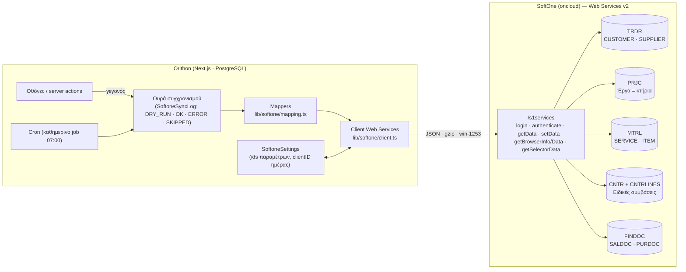

### 5α.2 Σύνδεση και συνεδρία

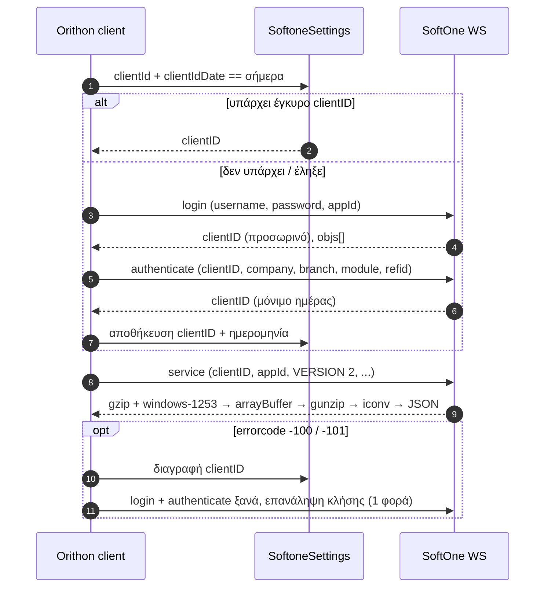

### 5α.3 Πελάτης → CUSTOMER (upsert με έλεγχο ΑΦΜ)

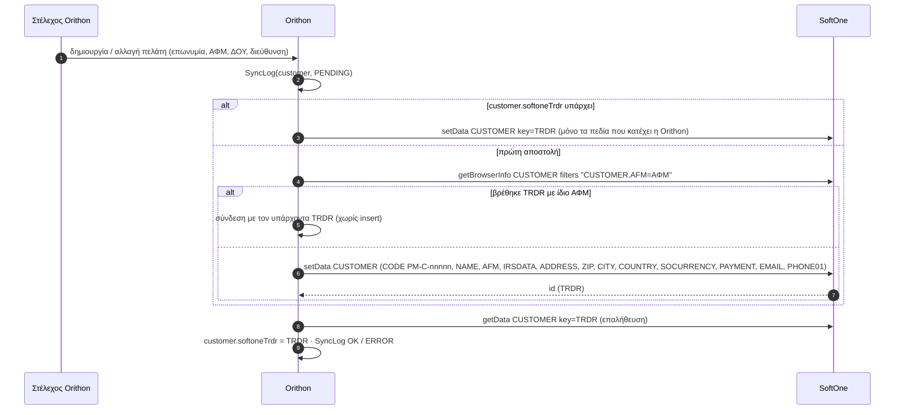

Η ίδια ροή ισχύει για **Συνεργάτη → SUPPLIER** (SODTYPE 12, κωδικοί `PM-S-`) με επιπλέον το IBAN στον child πίνακα τραπεζικών λογαριασμών (σημείο συμφωνίας 5).

### 5α.4 Κτήριο → PRJC (Έργο)

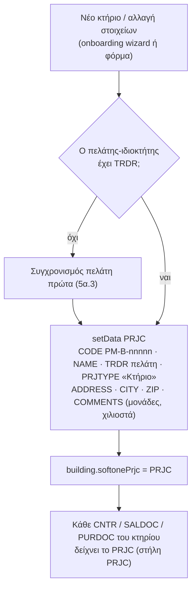

### 5α.5 Κατάλογος υπηρεσιών → SERVICE / ITEM (MTRL)

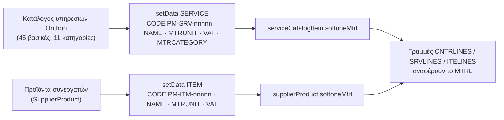

### 5α.6 Σύμβαση έργου → δύο CNTR (back-to-back)

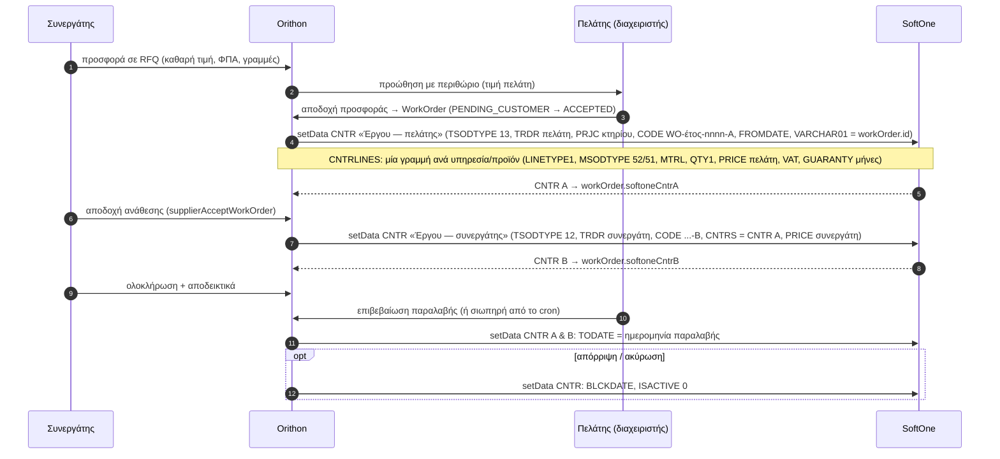

Καταστάσεις WorkOrder ↔ ενέργεια SoftOne:

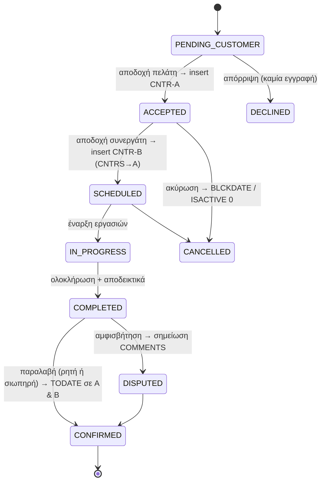

### 5α.7 Πακέτο διαχείρισης ακινήτου → CNTR περιοδική

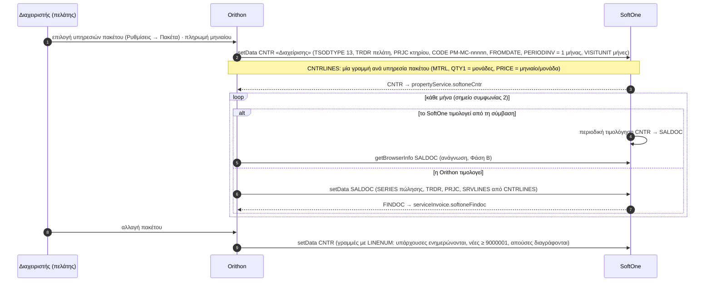

### 5α.8 Τιμολόγιο συνεργάτη → PURDOC (Φάση Β)

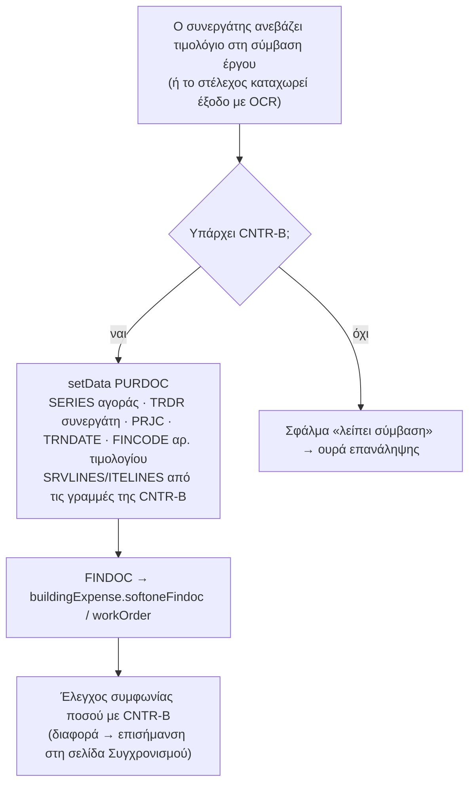

### 5α.9 Ανάγνωση από SoftOne (Φάση Β) και καθημερινό job

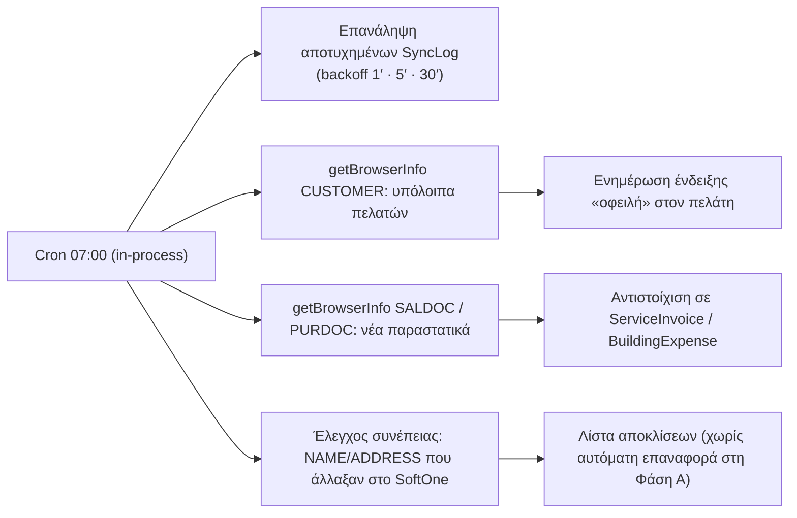

### 5α.10 Κύκλος ζωής μιας εγγραφής συγχρονισμού

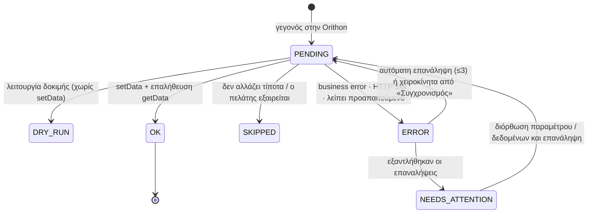

## 6. Κωδικοί, μοναδικότητα, συγκρούσεις

- Κωδικοί: `PM-C-`, `PM-S-`, `PM-B-`, `PM-SRV-`, `PM-ITM-`, `PM-MC-` + αύξων 5 ψηφίων· συμβάσεις έργου `WO-ΕΤΟΣ-ΑΑΑΑ-A/B`. Τα prefixes είναι παράμετροι (αν ο integrator θέλει άλλο σχήμα).
- Σύγκρουση ΑΦΜ (ίδιο ΑΦΜ σε πελάτη και προμηθευτή): επιτρέπεται — διαφορετικά TRDR (SODTYPE 13/12)· το SoftOne μπορεί να τα «συγχρονίζει» (TRDTYPE1) αν το θέλει ο πελάτης.
- Αλλαγές στο SoftOne σε πεδία που κατέχει η Orithon (όνομα, διεύθυνση) **δεν** γυρίζουν πίσω στη Φάση Α· επισημαίνονται στον έλεγχο συνέπειας.

## 7. Παράμετροι που πρέπει να προετοιμάσει ο integrator (checklist)

| # | Στοιχείο | Παράδειγμα / Σχόλιο |
|---|---|---|
| 1 | Web Account + AppID + REFID χρήστη | λογαριασμός `orithon-api` |
| 2 | COMPANY / BRANCH | 1 εταιρεία, 1 υποκατάστημα |
| 3 | Χώρα Ελλάδα, νόμισμα EUR (ids) | COUNTRY, SOCURRENCY |
| 4 | Συντελεστές ΦΠΑ (ids) 24 %, 13 %, 6 %, 0 % | VAT |
| 5 | Μονάδες μέτρησης (ids): τεμ., ώρα, επίσκεψη, τ.μ., μήνας, εργασία | MTRUNIT |
| 6 | Τρόποι πληρωμής (ids) + αντιστοίχιση ημερών πίστωσης | PAYMENT |
| 7 | **Τρεις τύποι συμβάσεων**: «Έργου — πελάτης», «Έργου — συνεργάτης», «Διαχείρισης (περιοδική)» | CNTRTYPE (+ SERIES δόσης/τιμολόγησης αν το SoftOne παράγει τα παραστατικά) |
| 8 | Χαρακτηρισμός σύμβασης ($CNTRTYPE1), μονάδα χρόνου «μήνες» ($SrvTimeUnit) | ids |
| 9 | Σειρές παραστατικών: τιμολόγιο υπηρεσιών (πώληση), τιμολόγιο αγοράς υπηρεσιών/ειδών | SERIES |
| 10 | Τύπος έργου για κτήρια ($PRJTYPE), προαιρετικά κατηγορίες υπηρεσιών/ειδών | |
| 11 | Πίνακας τραπεζικών λογαριασμών συναλλασσομένου (όνομα child table + πεδία) | για IBAN συνεργατών |
| 12 | Επιβεβαίωση ότι η έκδοση SoftOne υποστηρίζει CNTR/CNTRLINES όπως περιγράφεται (Series 5/6, Web Services v2) | |

Οι τιμές 3–10 καταχωρούνται από τον διαχειριστή της Orithon στη σελίδα «SoftOne → Παράμετροι» (dropdowns που γεμίζουν live από το SoftOne).

## 8. Χειρισμός σφαλμάτων

| Κατάσταση | Ενέργεια |
|---|---|
| `errorcode -100/-101` | νέο login, επανάληψη μία φορά |
| `success:false` (business error) | καταγραφή, εμφάνιση στη σελίδα Συγχρονισμού, χειροκίνητη επανάληψη |
| HTTP 5xx / timeout | επανάληψη με backoff (1′, 5′, 30′), μετά «χρειάζεται προσοχή» |
| Έλλειψη προαπαιτούμενου (π.χ. πελάτης χωρίς TRDR πριν το έργο) | αυτόματος συγχρονισμός του προαπαιτούμενου πρώτα, αλλιώς σφάλμα με σαφή αιτία |
| `success:true` αλλά τιμή δεν άλλαξε | επαλήθευση με `getData` μετά από κάθε update (γνωστή συμπεριφορά σε μερικά αντικείμενα) |

## 9. Ασφάλεια & GDPR

- Στέλνονται μόνο τα στοιχεία που χρειάζεται η λογιστική (επωνυμία, ΑΦΜ, ΔΟΥ, διεύθυνση, επικοινωνία). Δεν στέλνονται δεδομένα ενοίκων/ιδιοκτητών των κτηρίων, ούτε φωτογραφίες βλαβών.
- Το ιστορικό συγχρονισμού (payload) κρατείται 12 μήνες.
- Πρόσβαση στις σελίδες SoftOne μόνο για ρόλο Super Admin / Admin (δικαιώματα `softone-*`).

## 10. Τι υλοποιεί η Orithon (μετά τη συμφωνία)

Ομάδα μενού **SoftOne** με: (1) Επισκόπηση & δοκιμή σύνδεσης, (2) Δομή δεδομένων & έλεγχοι ποιότητας, (3) Παράμετροι, (4) Συγχρονισμός (ουρά, προεπισκόπηση, ιστορικό). Client Web Services, mappers με unit tests, sync engine με dry-run, καθημερινό job. Στη βάση της Orithon έχουν ήδη προστεθεί οι στήλες-σύνδεσμοι (`softoneTrdr`, `softonePrjc`, `softoneMtrl`, `softoneCntrA/B`, `softoneCntr`, `softoneFindoc`) και οι πίνακες παραμέτρων/ιστορικού.

## 11. Σημεία προς συμφωνία με τον integrator

1. Έκδοση SoftOne και διαθεσιμότητα Web Services v2 · ονόματα/δομή CNTR, CNTRLINES, CNTRTYPE στην εγκατάσταση της Orithon (επιβεβαίωση ότι ταυτίζονται με τα παραπάνω).
2. Ποιος παράγει τα περιοδικά παραστατικά της σύμβασης διαχείρισης (SoftOne από CNTR ή Orithon με SALDOC).
3. Ένα MTRL ανά υπηρεσία καταλόγου (προτεινόμενο) ή ανά συνεργάτη-υπηρεσία.
4. Σχήμα κωδικών (prefixes) ή χρήση της αρίθμησης του SoftOne.
5. Child table τραπεζικών λογαριασμών για IBAN συνεργατών.
6. Αντιστοίχιση ημερών πίστωσης → PAYMENT.
7. Χρήση VARCHAR01 στο CNTR για το Orithon id (ή άλλο ελεύθερο πεδίο).
8. Παράθυρο δοκιμών: test company ή αντίγραφο βάσης πριν το production.

---

*Παράρτημα Α — Αρχεία αναφοράς Orithon:* `lib/softone/mapping.ts` (μητρώο αντιστοίχισης σε κώδικα), `lib/softone/client.ts` (client Web Services), `prisma/schema.prisma` (πεδία `softone*`, `SoftoneSettings`, `SoftoneSyncLog`).
