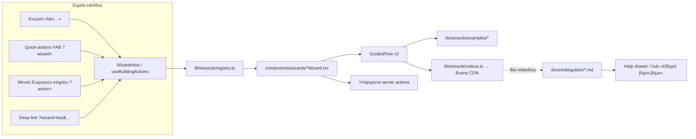

# Οδηγούμενη καταχώριση (wizards) με παράδειγμα, video και οδηγούς — σχεδιασμός

Ημερομηνία: 2026-10-23 · Κατάσταση: εγκεκριμένο από τον χρήστη (brainstorming 2026-10-23) · Επόμενο: `docs/superpowers/plans/2026-10-23-guided-wizards.md`

## 1. Πρόβλημα και στόχος

Οι διαχειριστές-πελάτες μπερδεύονται στην **αρχικοποίηση**: ακίνητα, κτήρια, μονάδες, χιλιοστά, υπηρεσίες/πακέτο. Οι σημερινές φόρμες «Νέο…» είναι πυκνές (όλα τα πεδία μαζί, χωρίς εξήγηση του «γιατί»).

Στόχος (λόγια του χρήστη): «σε κάθε αρχικοποίηση … wizards με πολύ εύκολο τρόπο καταχώρισης. Όλα σε modal και στο τέλος ένα παράδειγμα πώς εφαρμόζεται η καταχώριση. Για κάθε wizard … επεξηγηματικό video (Remotion) που εκτός από την καταχώριση εξηγεί γιατί το κάνουμε, ποια η χρήση, με ενσωμάτωση στο wiki και στο help.»

**Επιτυχία:** ένας νέος διαχειριστής στήνει Πελάτη → Ιδιοκτησία → Κτήριο (μονάδες) → Χιλιοστά → Πακέτο υπηρεσιών χωρίς να ρωτήσει κανέναν, βλέποντας σε κάθε βήμα τι σημαίνει αυτό που δίνει και στο τέλος **τι θα προκύψει** (π.χ. πώς θα μοιραστεί μια δαπάνη 1.000 €).

## 2. Αποφάσεις (κλειδωμένες)

| # | Απόφαση | Επιλογή |
|---|---------|---------|
| 1 | Λίστα wizards | Όλα, κατά αλυσίδα: Πελάτης → Ιδιοκτησία → Κτήριο+μονάδες → Χιλιοστά → Κοινόχρηστος χώρος + στοιχείο διαχείρισης → Υπηρεσία καταλόγου & Πακέτο ιδιοκτησίας → Συνεργάτης. Συν τα 4 υπάρχοντα (ένοικος/ιδιοκτήτης, τακτική συντήρηση, ανακοίνωση, συνέλευση) που μεταφέρονται στο νέο πλαίσιο. |
| 2 | Σχέση με τις φόρμες «Νέο…» | Το wizard γίνεται **προεπιλογή** σε κάθε σημείο δημιουργίας (κουμπί, FAB, μενού Ενεργειών, deep link). Μέσα του υπάρχει «Προτιμώ την απλή φόρμα» (η υπάρχουσα φόρμα παραμένει και εξυπηρετεί την επεξεργασία). |
| 3 | Videos | Κείμενο + κίνηση, **χωρίς ήχο** (muted/autoplay-safe), ελληνικά, 60–90 s, 16:9 1280×720, ένα ανά wizard = **12** (8 νέα + 4 υπάρχοντα, τα 4 τελευταία). |
| 4 | «Με AI» στο κτήριο | Κουμπί στο πρώτο βήμα του wizard κτηρίου που οδηγεί στον υπάρχοντα AI onboarding (`/super-admin/customers/[id]/onboarding`). Ο AI wizard μένει άθικτος. |
| 5 | Οδηγοί wiki | Ξεχωριστή ενότητα «Οδηγοί βήμα-βήμα» (`docs/wiki/guides/*.md`, ένας ανά wizard) με video και Mermaid διάγραμμα· τα άρθρα σελίδων παραπέμπουν σε αυτούς. |
| 6 | Διαγράμματα | **Mermaid** στο Markdown του wiki (ήδη υποστηρίζεται από `components/cms/Markdown.tsx`). Το `/drawio-skill` δεν υπάρχει στη λίστα skills της συνεδρίας· αν προστεθεί αργότερα, τα `.drawio` μπορούν να μπουν στο motion-studio μέσω του υπάρχοντος `scripts/drawio2json.mjs` + `shared/DrawioDiagram.tsx`. |
| 7 | Εκκρεμές commit | Τα αρχεία του μενού «Ενέργειες» κτηρίου (συνεδρία «modals») έγιναν commit ως έχουν (`815c859`) ώστε τα wizards να μπουν στο ίδιο registry. |
| 8 | Prisma | **Καμία αλλαγή schema.** |

## 3. Αρχιτεκτονική



### 3.1 Registry `lib/wizards/registry.ts` (pure, client-safe, tests)

```ts
export type WizardKey =
  | "customer-new" | "property-new" | "building-new" | "millesimes-setup"
  | "common-area-new" | "service-new" | "package-setup" | "supplier-new"
  // υπάρχοντα, μεταφέρονται στο v2
  | "occupant-assign" | "task-new" | "announcement-new" | "assembly-new";

export type WizardScope = "global" | "customer" | "property" | "building";

export type WizardDef = {
  key: WizardKey;
  title: string;            // «Νέος πελάτης βήμα-βήμα»
  short: string;            // «Νέος πελάτης» (κουμπιά, FAB)
  icon: string;             // react-icons/ri *Line name
  scope: WizardScope;       // ποιο id χρειάζεται στο URL: customerId / propertyId / buildingId
  /** RBAC module + action (requirePermission στον server, can() στον client) — για global/customer/property. */
  permission?: { module: string; action: "create" | "edit" };
  /** BuildingCaps key — για scope "building" (το μενού Ενεργειών φιλτράρει με caps, όχι ρόλους). */
  cap?: keyof BuildingCaps;
  superAdminOnly?: boolean; // master data (customer, property, building, service)
  videoKey: string;         // «Customer», «Property», … → Orithon-Guide-<Key>-16x9
  guideSlug: string;        // docs/wiki/guides/<slug>.md
  /** Επόμενο βήμα της αλυσίδας που προτείνεται στην οθόνη «Έγινε!». */
  next?: WizardKey;
};
export const WIZARDS: readonly WizardDef[];
export function wizardHref(base: string, key: WizardKey, ctx?: { customerId?: string; propertyId?: string; buildingId?: string }): string; // `${base}?wizard=key&propertyId=…`
export function isWizardKey(s: unknown): s is WizardKey;
export const WIZARD_PARAM = "wizard";
```

Αλυσίδα `next`: customer-new → property-new → building-new → millesimes-setup → package-setup. Το `common-area-new` προτείνει `millesimes-setup`/`package-setup` ανάλογα· τα υπόλοιπα δεν έχουν `next`.

**Ενσωμάτωση στο registry κτηρίου (όχι παράλληλο σύστημα):** στο `lib/building-actions.ts` προστίθεται προαιρετικό πεδίο `wizard?: WizardKey` στις παρακάτω υπάρχουσες εγγραφές:

| BuildingActionKey | wizard |
|---|---|
| `millesimes-calc` | `millesimes-setup` (το wizard αντικαθιστά το MillesimesModal ως προεπιλογή· το modal μένει ως «απλή φόρμα») |
| `managed-item-new` | `common-area-new` (το wizard καλύπτει κοινόχρηστο χώρο **και** στοιχείο διαχείρισης) |
| `task-new` | `task-new` |
| `announcement-new` | `announcement-new` |
| `assembly-new` | `assembly-new` |
| `occupant-assign` | `occupant-assign` |

Το `BuildingActionHost` ανοίγει το wizard όταν η εγγραφή έχει `wizard`, αλλιώς το υπάρχον modal. Έτσι το `?action=task-new` συνεχίζει να δουλεύει και το ⌘K (συνεδρία «Υπο-έργο 2») χρειάζεται μόνο το registry. Νέα εγγραφή κτηρίου: **καμία** (τα wizards κτηρίου αντιστοιχούν σε υπάρχοντα keys). Το `unit-new` μένει απλή φόρμα (μία μονάδα = 5 πεδία· οι πολλές μονάδες μπαίνουν από το wizard κτηρίου).

### 3.2 `WizardHost` (components/wizards/WizardHost.tsx)

Client component στο `AppShell` της εταιρικής επιφάνειας (`app/(company)/layout.tsx` → `components/admin/app-shell.tsx`). Διαβάζει **μία φορά** `?wizard=<key>` (+ `customerId`/`propertyId`/`buildingId`), ελέγχει `isWizardKey` και ότι ο χρήστης έχει το δικαίωμα (από τα resolved perms που ήδη τροφοδοτούν το sidebar — `can(perms, module, action)`), κάνει `router.replace` χωρίς το query (ίδιο μοτίβο με `useBuildingActions`), και αποδίδει το wizard. Για scope `building` το `WizardHost` δεν αναλαμβάνει — παραπέμπει σε `buildingActionHref(base, key)` ώστε να ανοίξει μέσα στη σελίδα κτηρίου με τα δεδομένα της (ένα μόνο σημείο αλήθειας για caps).

Context που λείπει (π.χ. `property-new` χωρίς `customerId`): το wizard ξεκινά με ένα επιπλέον βήμα «Για ποιον πελάτη;» (αναζήτηση) αντί να αποτύχει.

### 3.3 GuidedFlow v2 (`components/ui/guided-flow.tsx`, συμβατό προς τα πίσω)

Υπάρχον: `GuidedFlow`, `FlowStep`, `ChoiceCards`, `SummaryList`. Προσθήκες:

- **Ράγα προόδου**: κλικ στα ολοκληρωμένα βήματα για επιστροφή· κείμενο «Βήμα 2 από 6»· στο κινητό συμπτύσσεται σε μπάρα + τίτλο τρέχοντος βήματος.
- **`draftKey?: string`**: αυτόματη αποθήκευση των τιμών (ο caller δίνει `draft: { value, restore(v) }`) σε `localStorage` κάτω από `wizard-draft:<key>:<ctxId>` με χρονοσφραγίδα· στο άνοιγμα, αν υπάρχει draft < 7 ημερών: κάρτα «Βρήκαμε μια μισοτελειωμένη καταχώριση από <ημ/νία>. Συνέχεια / Από την αρχή». Καθαρίζεται στο finish.
- **Επιβεβαίωση κλεισίματος** όταν υπάρχουν αλλαγές (`dirty`) — «Να κρατήσουμε πρόχειρο;» Ναι (κρατά draft) / Απόρριψη / Πίσω.
- **Βήμα «Παράδειγμα εφαρμογής»** (`example?: { title?: string; render: () => ReactNode; video?: WizardVideo }`): αποδίδεται **πριν** την αποθήκευση ως τελευταίο βήμα· περιέχει το υπολογισμένο παράδειγμα και, αν δοθεί `video`, κουμπί «Δείτε το video (1′20″)» που ανοίγει inline player (`<video controls playsInline muted preload="metadata" poster>`), συν σύνδεσμο «Ο πλήρης οδηγός» → hub `?a=<guideSlug>`.
- **Οθόνη «Έγινε!»** (`onFinish` επιστρέφει `{ done: { title, lines?, next?: { label, onClick }[] } }`): τσεκ, τι δημιουργήθηκε, κουμπιά «Επόμενο βήμα: …» (από `next` του registry) και «Κλείσιμο». Οι υπάρχουσες ροές που επιστρέφουν `void` κλείνουν όπως σήμερα.
- **Προσβασιμότητα/κινητό**: `role="dialog" aria-labelledby`, focus στο heading του βήματος σε κάθε αλλαγή, Enter = Συνέχεια (όχι σε textarea), 44 px στόχοι, bottom sheet ≤767 px (υπάρχον CSS `.ui-modal`), `prefers-reduced-motion` απενεργοποιεί τις μεταβάσεις βημάτων (fade/slide 180 ms).
- Νέο βοηθητικό `NumberField` (δεκαδικά με κόμμα, μονάδα «τ.μ.», «€»), `UnitsGrid` (επεξεργάσιμος πίνακας μονάδων, ξαναχρησιμοποιεί τη λογική του onboarding πίνακα), `ExampleCard`/`ExampleTable` (ομοιόμορφη εμφάνιση παραδειγμάτων).

### 3.4 Παραδείγματα = καθαρές συναρτήσεις (`lib/wizards/examples/*.ts`, TDD)

Κάθε wizard έχει μία pure συνάρτηση `exampleFor<Key>(input)` που επιστρέφει δεδομένα για το βήμα «Παράδειγμα», υπολογισμένα **από τις τιμές που μόλις δόθηκαν** με τις ίδιες βιβλιοθήκες που χρησιμοποιεί ο server (ώστε preview == αποθηκευμένο):

| Wizard | Παράδειγμα | Βιβλιοθήκη |
|---|---|---|
| Πελάτης | Κάρτα «Τι ακολουθεί»: κωδικός C0000x, λογαριασμός σύνδεσης (αν δόθηκε), «1η ιδιοκτησία → κτήριο → μονάδες», πού θα δει τιμολόγια | — |
| Ιδιοκτησία | Δέντρο Πελάτης › Ιδιοκτησία › Κτήριο (αρχικό) με διεύθυνση· σημείωση «το πακέτο υπηρεσιών ορίζεται εδώ» | — |
| Κτήριο + μονάδες | Πίνακας μονάδων με 3 σετ χιλιοστών από τα τ.μ./ορόφους που δόθηκαν (Σ=1000 το καθένα), προειδοποίηση για μονάδες χωρίς τ.μ. | `lib/millesimes.ts` (`distributeWeights`, `elevatorWeight`), `buildOnboardingPayload` |
| Χιλιοστά | «Δαπάνη 1.000 € καθαρισμού / 600 € ανελκυστήρα / 2.000 € πετρελαίου» → ποσό ανά μονάδα και ανά σετ, με νομική βάση ανά σετ (Ν.3741/1929, ΚΥΑ 20.8.1997, Ν.1512/1985) | `lib/expenses/allocation.ts`, `lib/expenses/basis.ts` |
| Κοιν. χώρος + στοιχείο | «Ο χώρος μετρά στις υπηρεσίες ανά κοινόχρηστο χώρο: +X €/μήνα αν ενεργοποιηθεί η Υ»· λίστα στοιχείων διαχείρισης του χώρου και πότε συντηρούνται | τιμές από τον κατάλογο υπηρεσιών (props) |
| Υπηρεσία καταλόγου | Τι θα χρεώσει σε 2 ενδεικτικές ιδιοκτησίες (5 μονάδες/1 κτήριο/2 κοιν. χώροι · 12 μονάδες/2 κτήρια/4 κοιν. χώροι) ανά μοντέλο τιμολόγησης, PER_ZONE με ζώνες | ίδια λογική με `lineFor` του `PropertyPackages.tsx` → εξάγεται σε `lib/wizards/examples/package.ts` και επαναχρησιμοποιείται από το component |
| Πακέτο ιδιοκτησίας | Μηνιαίο σύνολο από τις επιλεγμένες υπηρεσίες × πραγματικά counts της ιδιοκτησίας (units/buildings/commonAreas από `listPropertyPackage`) + προπληρωμένα λεπτά συνελεύσεων | ό.π. |
| Συνεργάτης | Χρονογραμμή RFQ → προσφορά → αποδοχή → σύμβαση back-to-back με τις δύο τιμές (προμηθευτή/πελάτη) και επιβάρυνση ζώνης αν δόθηκε βάση | `lib/distance/zones` |
| Ένοικος/ιδιοκτήτης | Τι θα βλέπει ο χρήστης (surface, λογαριασμοί της μονάδας, ποσοστά ενοικιαστή/ιδιοκτήτη) | split settings του κτηρίου (props) |
| Τακτική συντήρηση | Οι 3 επόμενες ημερομηνίες από συχνότητα + ημερομηνία, πότε έρχεται η υπενθύμιση | pure date helper |
| Ανακοίνωση | Πώς φαίνεται στο portal/πινακίδα (preview κάρτα), ποιοι ειδοποιούνται | — |
| Συνέλευση | Ημερολόγιο: πρόσκληση → απαρτία (χιλιοστά παρόντων) → πρακτικά, κατανάλωση προπληρωμένων λεπτών | `distributeWeights` |

### 3.5 Αποθήκευση: υπάρχοντα server actions, δύο νέα

| Wizard | Server action |
|---|---|
| Πελάτης | `createCustomer` (customers.ts) |
| Ιδιοκτησία | `createProperty` (sameAddressBuilding, managed, buildingName) |
| Κτήριο + μονάδες | **νέο** `createBuildingWithUnits(propertyId, building, units)` στο `app/actions/buildings.ts`: `requireSuperAdmin`, Zod, `buildOnboardingPayload`-συμβατός υπολογισμός χιλιοστών, μία συναλλαγή (building + units + `unitsCount`), `touchBuildingDistance`, `revalidatePath`. Ο AI onboarding **δεν** αλλάζει. |
| Χιλιοστά | **νέο** `applyMillesimesSetup(buildingId, { general: "AUTO" \| { unitId: value }[], elevator: { enabled, surchargePerFloor, exemptGroundFloor, manual? }, heating: { basis: "HEATING_MILLESIMES" \| "METERED_70_30" \| "EQUAL_PER_UNIT", manual? } })` στο `building-millesimes.ts`: `requireBuildingCap(editMillesimes)`, μία συναλλαγή που γράφει `millesimes*`, `millesimes*Source`, παραμέτρους ανελκυστήρα και `setCategoryBasis` για θέρμανση. Επαναχρησιμοποιεί τη λογική του `recalculateMillesimes`. |
| Κοιν. χώρος + στοιχείο | `createCommonArea` (buildings.ts) + προαιρετικά `createManagedItem` ×N (managed-items.ts) |
| Υπηρεσία | `createService` (services.ts) |
| Πακέτο | `setPropertyService` ×N + `addPrepaidMinutes` (property-package.ts) |
| Συνεργάτης | `createSupplier(input, scope)` (suppliers.ts) |
| Υπάρχοντα 4 | όπως σήμερα |

Κανόνες: κάθε wizard κάνει **μία** αποθήκευση στο τέλος (όχι ανά βήμα)· σφάλμα server → μένει στο βήμα σύνοψης με το μήνυμα· τα guards είναι τα υπάρχοντα (`requireSuperAdmin`, `requireBuildingCap`, `requirePermission`).

### 3.6 Σημεία εισόδου που αλλάζουν

| Σήμερα | Μετά |
|---|---|
| `CustomersClient` «Νέος Πελάτης» → Modal φόρμα | ανοίγει `CustomerWizard` (η φόρμα μένει για επεξεργασία) |
| `CustomerTree` / `CustomersClient` «Νέα ιδιοκτησία» → `AddPropertyModal` | `PropertyWizard` (το `AddPropertyModal` μένει ως «απλή φόρμα») |
| `CustomerTree` «Νέο κτήριο» → `BuildingModal` | `BuildingWizard` (το `BuildingModal` μένει για επεξεργασία/απλή φόρμα) |
| Μενού Ενεργειών `millesimes-calc` → `MillesimesModal` | `MillesimesWizard` |
| `ManagedItemsPanel` «Νέο στοιχείο» / `managed-item-new` | `CommonAreaWizard` |
| `ServicesClient` «Νέα υπηρεσία» | `ServiceWizard` |
| `PropertyPackages` (toggle ανά υπηρεσία) | κουμπί «Ρύθμιση πακέτου βήμα-βήμα» → `PackageWizard`· τα toggles μένουν |
| `SuppliersClient` «Νέος συνεργάτης» | `SupplierWizard` (το `SupplierFormModal` μένει για επεξεργασία) |
| FAB `lib/quick-actions.ts` | στις σελίδες πελατών/ιδιοκτησιών/υπηρεσιών/συνεργατών: `?wizard=<key>` hrefs (relative, περνούν το allowed-filter όπως τα `?action=`) |
| `/super-admin/onboarding` (AI) | αμετάβλητο· το κουμπί «Περιγράψτε το στον βοηθό» του `BuildingWizard` οδηγεί εκεί |

### 3.7 Videos (motion-studio)

- Νέο data-driven composition `src/projects/orithon/Guide/` (πρότυπο: `dgespa/Explainer` — `types.ts`, `scenes.tsx`, `videos.ts`, `index.tsx`), με Orithon brand (`orithon/brand.ts`), τα υπάρχοντα primitives (`ui.tsx`: Window, Card, Badge, Button, Cursor, CheckCircle…) και icons (`icons.tsx`). Τύποι σκηνών: `title`, `why` (3 κάρτες «γιατί»), `flow` (βήματα), `form` (mockup του wizard με τον κέρσορα να συμπληρώνει), `split` (κατανομή ποσού), `table` (μονάδες/χιλιοστά), `tree` (ιεραρχία), `points`, `end`. Κάθε σκηνή = ένα μήνυμα + υπότιτλος-κάρτα· διάρκεια από το κείμενο (0,4 s + 17 χαρ./s, όπως το Kolleris).
- `videos.ts`: 12 εγγραφές με `key` = `videoKey` του registry. Compositions `Orithon-Guide-<Key>-16x9`, 1280×720, 30 fps, 60–90 s. Render `MAX_MB=4 npm run render -- Orithon-Guide --only=mp4,poster`.
- Δημοσίευση: `node scripts/publish.mjs --project /Volumes/EXTERNALSSD/propertymanagement --filter Orithon-Guide --folder "Οδηγοί"` → Bunny `media/videos/…` + `MediaFile` rows. Το `out/Orithon-Guide.publish.json` → script `scripts/wizard-videos.mjs` στο project που γράφει `lib/wizards/videos.ts` (`{ [videoKey]: { src, poster, seconds } }`). Ο client δεν «μαντεύει» URLs.
- Σενάρια (ελληνικά, για μη τεχνικούς): κάθε video απαντά 1) γιατί χρειάζεται αυτή η καταχώριση, 2) τι θα κερδίσει ο διαχειριστής, 3) τα βήματα, 4) το παράδειγμα, 5) πού το βρίσκει μετά. Ονόματα/ποσά φανταστικά.

### 3.8 Wiki & Help

- Νέος φάκελος `docs/wiki/guides/<slug>.md` με frontmatter `title`, `kind: guide`, `wizard: <WizardKey>`, `roles`, `area`, `summary`, `prompts`, `related`, `video: <url>`, `videoPoster: <url>`, `minutes`. Σώμα: «Γιατί», «Πριν ξεκινήσετε», «Βήμα-βήμα», «Παράδειγμα», Mermaid διάγραμμα ροής, «Συχνές ερωτήσεις», «Πού το βρίσκω μετά».
- `lib/help`: `WikiArticleMeta` παίρνει `kind?: "page" | "guide"`, `wizard?`, `video?`, `videoPoster?`, `minutes?`. `loadWikiIndex` διαβάζει και `guides/`. `groupArticlesByArea` βάζει τους οδηγούς σε ομάδα «Οδηγοί βήμα-βήμα» πρώτη. Το `coverage.test.ts` εξαιρεί `kind: guide` από τον έλεγχο route και προσθέτει: κάθε `WIZARDS[].guideSlug` υπάρχει, κάθε guide έχει έγκυρο `wizard`, κάθε `videoKey` έχει URL στο `videos.ts` (όταν υπάρχει).
- `/api/help/article` επιστρέφει `video`/`videoPoster`/`minutes`· `HelpDrawer` και `HelpCenter` δείχνουν `<HelpVideo>` (lazy, poster, controls, muted) πάνω από το Markdown. Το `Markdown.tsx` παραμένει sanitized (κανένα raw `<video>` στο md).
- Τα άρθρα σελίδων (`super-admin-customers.md`, `super-admin-properties.md`, `super-admin-buildings-detail.md`, `super-admin-services.md`, `super-admin-suppliers.md`, `super-admin-properties-detail.md`, `building-detail.md`) παίρνουν `related` προς τους οδηγούς και μία πρόταση «Νέα καταχώριση; Ακολουθήστε τον οδηγό βήμα-βήμα».
- Ο AI βοηθός: τα `prompts` των οδηγών τροφοδοτούν το RAG όπως τα άρθρα (καμία αλλαγή κώδικα εκτός από το index).

## 4. Τα 8 νέα wizards — βήματα

Κάθε wizard: βήματα → Σύνοψη → **Παράδειγμα εφαρμογής** (+video) → Αποθήκευση → «Έγινε!» με επόμενο βήμα.

1. **Πελάτης** (SUPER_ADMIN, `customers:create`): Ποιος είναι; (Ιδιώτης/Εταιρεία κάρτες, όνομα) → Στοιχεία επικοινωνίας (email, τηλ.) → Φορολογικά (ΑΦΜ με έλεγχο μορφής, ΔΟΥ, διεύθυνση έδρας με AddressAutocomplete) → Πρόσβαση (κάρτες: «Να έχει λογαριασμό» / «Όχι τώρα»; email σύνδεσης) → Υπεύθυνος manager (προαιρετικό).
2. **Ιδιοκτησία** (SUPER_ADMIN, `properties:create`): Πελάτης (αν λείπει) → Όνομα & διεύθυνση (autocomplete, στίγμα) → Διαχείριση (κάρτες: «Τη διαχειρίζεται η εταιρεία» / «Αυτοδιαχείριση» με εξήγηση) → Πρώτο κτήριο (ίδια διεύθυνση; όνομα).
3. **Κτήριο + μονάδες** (SUPER_ADMIN, `properties:create`): Ιδιοκτησία (αν λείπει) → Βασικά (όνομα, διεύθυνση — προσυμπληρωμένη από την ιδιοκτησία, όροφοι, υπόγεια) + κουμπί «Περιγράψτε το στον βοηθό (AI)» → Εξοπλισμός (ασανσέρ/καυστήρας/πυρασφάλεια κάρτες, παράμετροι ανελκυστήρα όταν ναι) → Μονάδες (γεννήτρια: «Χ διαμερίσματα ανά όροφο, Ψ καταστήματα ισόγειο» → `UnitsGrid` επεξεργάσιμος: αριθμός, όροφος, τ.μ., τύπος) → Σύνοψη → Παράδειγμα (3 σετ χιλιοστών).
4. **Χιλιοστά** (cap `editMillesimes`, από σελίδα κτηρίου): Έχετε κανονισμό; (κάρτες «Όχι — υπολογισμός βάσει νόμου» / «Ναι — θα δώσω τα χιλιοστά») → Γενικά (αυτόματα από τ.μ. με προεπισκόπηση, ή πίνακας χειροκίνητης εισαγωγής με ζωντανό άθροισμα/1000) → Ανελκυστήρας (υπάρχει; προσαύξηση ανά όροφο, εξαίρεση ισογείου, προεπισκόπηση) → Θέρμανση (κάρτες: Κεντρική κατά χιλιοστά / Αυτονομία ωρομετρητές 70-30 / Ίσα ανά μονάδα· προεπισκόπηση) → Σύνοψη → Παράδειγμα (3 δαπάνες → ποσά ανά μονάδα).
5. **Κοινόχρηστος χώρος + στοιχεία** (cap `manageManagedItems`, μόνο managed): Ποιος χώρος; (κάρτες τύπων: κλιμακοστάσιο, είσοδος, λεβητοστάσιο, ταράτσα, αυλή/κήπος, πάρκινγκ, άλλο· όνομα, όροφος) → Τι υπάρχει εκεί να φροντίζουμε; (πολλαπλή επιλογή από `ManagedItemType` + ποσότητα) → Σύνοψη → Παράδειγμα (επίδραση στο πακέτο + λίστα στοιχείων).
6. **Υπηρεσία καταλόγου** (SUPER_ADMIN, `services:create`): Τι υπηρεσία; (όνομα, κωδικός αυτόματος από το όνομα, περιγραφή, «βασική (CORE)» ναι/όχι) → Πώς χρεώνεται; (κάρτες των 6 μοντέλων με εξήγηση· τιμή· για PER_ZONE πίνακας ζωνών) → Σύνοψη → Παράδειγμα (2 ενδεικτικές ιδιοκτησίες).
7. **Πακέτο ιδιοκτησίας** (`properties:edit`, από σελίδα ιδιοκτησίας): Τι περιλαμβάνει; (CORE προεπιλεγμένο, κάρτες υπηρεσιών με ζωντανό μηνιαίο κόστος από τα counts) → Συνελεύσεις (αν METERED_PREPAID: προπληρωμένα λεπτά) → Σύνοψη → Παράδειγμα (μηνιαίο σύνολο, πρώτο τιμολόγιο).
8. **Συνεργάτης** (`suppliers:create`, scope company· PROPERTY_ADMIN με `customer-suppliers:create` → private): Τι κάνει; (κατηγορίες πολλαπλής επιλογής) → Ποιος είναι; (επωνυμία, ΑΦΜ, email, τηλ.) → Από πού ξεκινά; (διεύθυνση βάσης → ζώνη, επιβάρυνση αυτοψίας) → Πρόσβαση (πρόσκληση χρήστη; → υπάρχον μηχανισμό invite) → Σύνοψη → Παράδειγμα (ροή RFQ → σύμβαση).

## 5. Ασφάλεια, δεδομένα, όρια

- Παραγωγή = τοπική ΒΔ: η επαλήθευση στον browser φτάνει μέχρι το βήμα «Παράδειγμα» **χωρίς Αποθήκευση**· καμία test εγγραφή.
- Δικαιώματα: ο client κρύβει, ο server αποφασίζει (υπάρχοντες guards). Data isolation: οι wizards δέχονται ids μόνο από context/URL και τα server actions επαληθεύουν scope όπως σήμερα.
- Draft σε `localStorage` μόνο για τιμές φόρμας (όχι κωδικοί — το πεδίο `loginPassword` εξαιρείται από το draft).
- Καμία αλλαγή στα `app/actions/*` εκτός από τα δύο νέα actions και ένα export (`lineFor` → lib).

## 6. Δοκιμές

- Vitest: `lib/wizards/registry.test.ts` (keys/hrefs/next/permissions), `lib/wizards/examples/*.test.ts` (κάθε παράδειγμα, αθροίσματα 1000/ποσά), `lib/wizards/draft.test.ts` (serialize/restore/expiry), `lib/help/coverage.test.ts` (guides ↔ registry ↔ videos), `lib/help/frontmatter.test.ts` (νέα πεδία), `lib/building-actions.test.ts` (`wizard` πεδίο), `lib/quick-actions.test.ts` (`?wizard=` hrefs), `app/actions/building-millesimes.test.ts` + `buildings.test.ts` για τα 2 νέα actions (mocked db).
- Browser (dev :3002, attach-3002): κάθε wizard ως το βήμα Παράδειγμα, deep link `?wizard=`, `?action=`, κινητό 375 px (bottom sheet), help drawer με video, hub ενότητα οδηγών. Screenshots σε scratchpad.
- Γνωστά προϋπάρχοντα: 9 tsc σφάλματα, ~339 eslint, 2 failing tests (building-caps, ai/assistant/actions). Κανένα **νέο**.

## 7. Εκτός πεδίου

Voice-over/TTS, 9:16 εκδόσεις, ενσωματωμένο AI chat στο wizard κτηρίου, αλλαγές στον AI onboarding, wizards για βλάβες/δαπάνες/εισπράξεις (ήδη έχουν δικές τους ροές), επεξεργασία υπαρχόντων εγγραφών μέσω wizard, drag-and-drop ορόφων, SoftOne sync.

## 8. Σειρά υλοποίησης (κάθε βήμα = commit + οδηγός + video)

0 Πλαίσιο: registry, GuidedFlow v2, WizardHost, help `kind: guide` + `<HelpVideo>`, motion-studio `Guide` composition skeleton → 1 Πελάτης → 2 Ιδιοκτησία → 3 Κτήριο+μονάδες → 4 Χιλιοστά → 5 Κοιν. χώρος → 6 Υπηρεσία & Πακέτο → 7 Συνεργάτης → 8 μεταφορά των 4 υπαρχόντων (παράδειγμα + video + οδηγός) → 9 render/publish όλων των videos, `videos.ts`, fresh review, memory `project_wizards.md`, hand-over note.
