# Ροές της εφαρμογής ανά λειτουργία

**Έκδοση 1.0 — 7 Σεπτεμβρίου 2026.** Το έγγραφο περιγράφει με διαγράμματα (Mermaid) **κάθε λειτουργία** της πλατφόρμας Orithon: ποιος την ξεκινά, από ποια βήματα περνά, ποιες καταστάσεις παίρνει και τι ειδοποιήσεις παράγει. Απευθύνεται στα στελέχη της εταιρείας, στους πελάτες-διαχειριστές και σε εξωτερικούς συνεργάτες (π.χ. integrator SoftOne). Η τεχνική τεκμηρίωση ανά αρχείο βρίσκεται στο `docs/wiki`.

> Σύμβαση ρόλων: **Στέλεχος** = SUPER_ADMIN / ADMIN / MANAGER / EMPLOYEE (εταιρεία διαχείρισης) · **Διαχειριστής** = PROPERTY_ADMIN (πελάτης) · **Ιδιοκτήτης / Ένοικος** = PROPERTY_OWNER / PROPERTY_RESIDENT · **Συνεργάτης** = COLLABORATOR (προμηθευτής).

## 0. Χάρτης της εφαρμογής

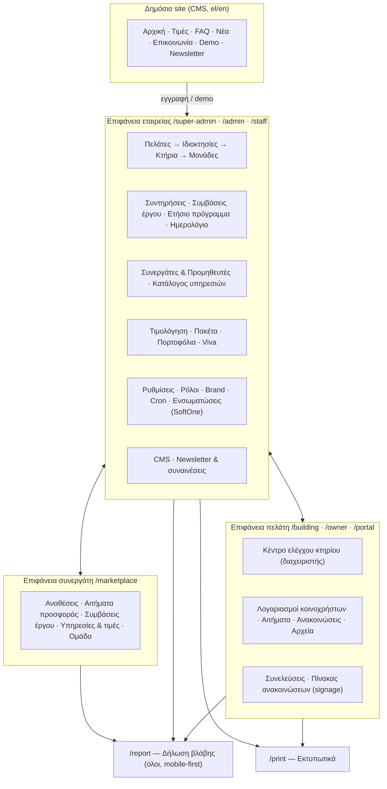

## 1. Είσοδος, ρόλοι και επιφάνειες

Κάθε χρήστης έχει **έναν** ρόλο· ο ρόλος ορίζει την επιφάνεια (εταιρεία / πελάτης / συνεργάτης) και τα δικαιώματα από τον πίνακα «Ρόλοι» (RBAC, επεξεργάσιμος από τον Super Admin). Ο Super Admin μπορεί να δει την εφαρμογή «ως» άλλος χρήστης (View-as) με πλήρη καταγραφή.

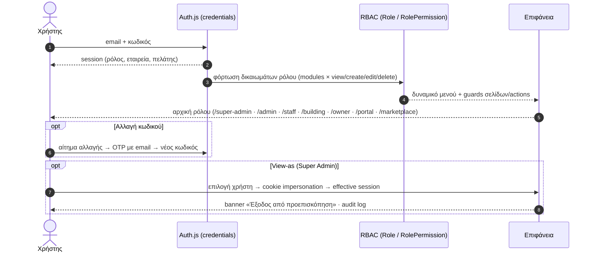

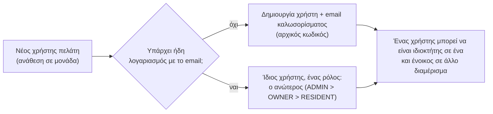

## 2. Νέα πολυκατοικία με AI (onboarding)

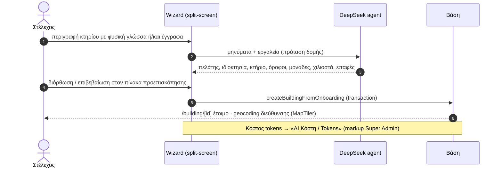

## 3. Πελάτες, ιδιοκτησίες, κτήρια, μονάδες, ένοικοι

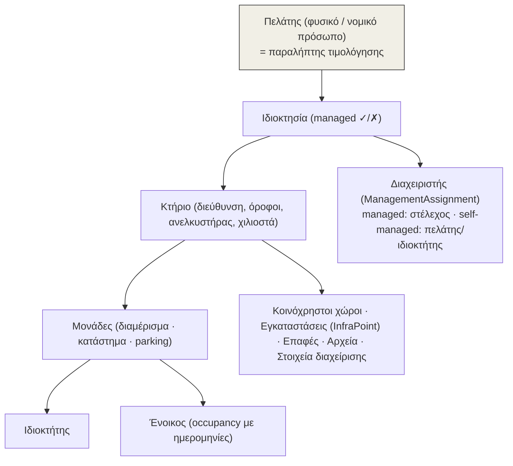

**Απομόνωση δεδομένων:** κάθε πελάτης βλέπει μόνο τα δικά του κτήρια, μονάδες, ενοίκους και ιδιωτικούς προμηθευτές· ο έλεγχος γίνεται σε κάθε server action (`requireBuildingCap`, `BuildingCaps`).

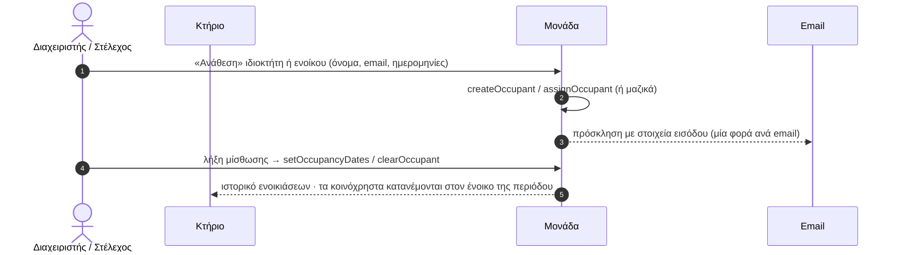

## 4. Έξοδα και κοινόχρηστα

Η κεντρική οικονομική ροή: από το παραστατικό μέχρι το ειδοποιητήριο και την είσπραξη.

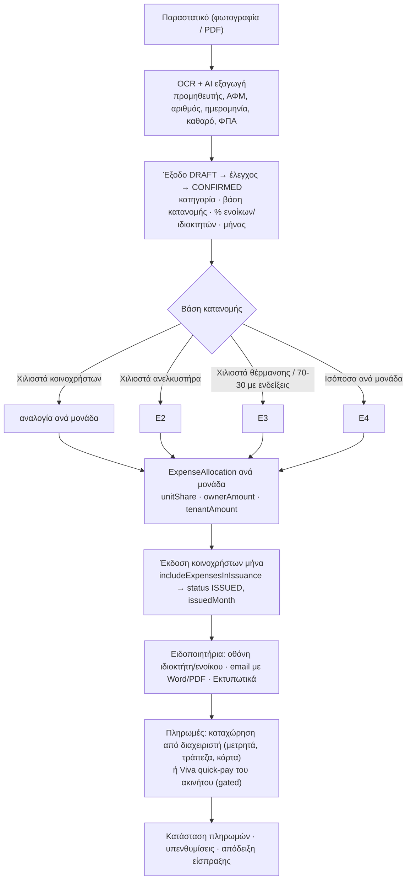

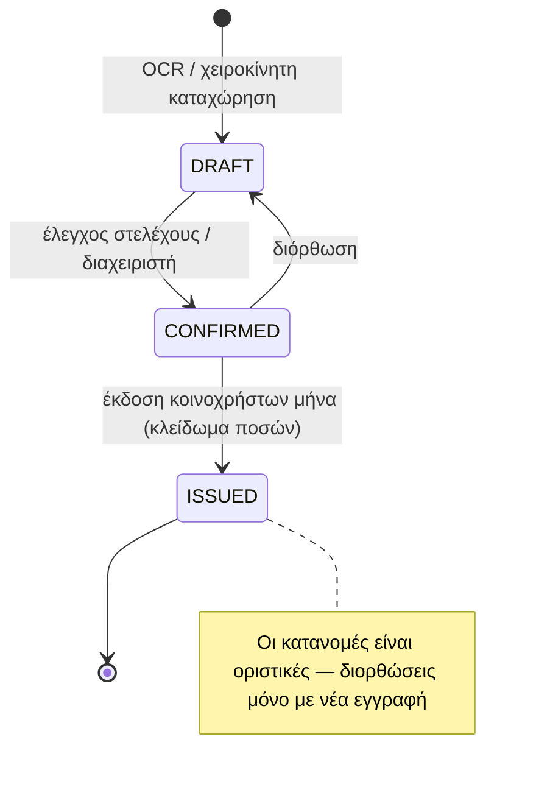

Χιλιοστά: τρία σετ (γενικά, ανελκυστήρα, θέρμανσης). Χωρίς κανονισμό υπολογίζονται αυτόματα βάσει νόμου (τ.μ., όροφος) με δυνατότητα χειροκίνητης παράκαμψης ανά μονάδα.

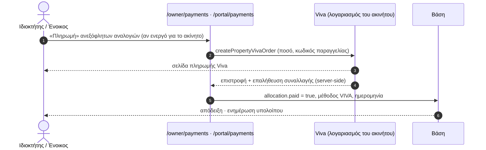

## 5. Ενδείξεις θέρμανσης

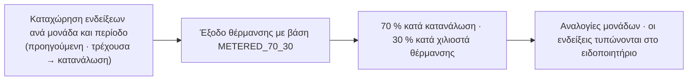

## 6. Δήλωση βλάβης και συντηρήσεις

Μία σελίδα `/report` για όλους (mobile-first, φωτογραφία). Ο κανόνας κάλυψης αποφασίζει αν η βλάβη καλύπτεται από τη σύμβαση διαχείρισης ή χρειάζεται προσφορά.

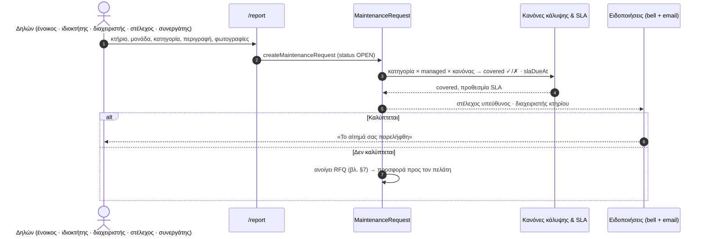

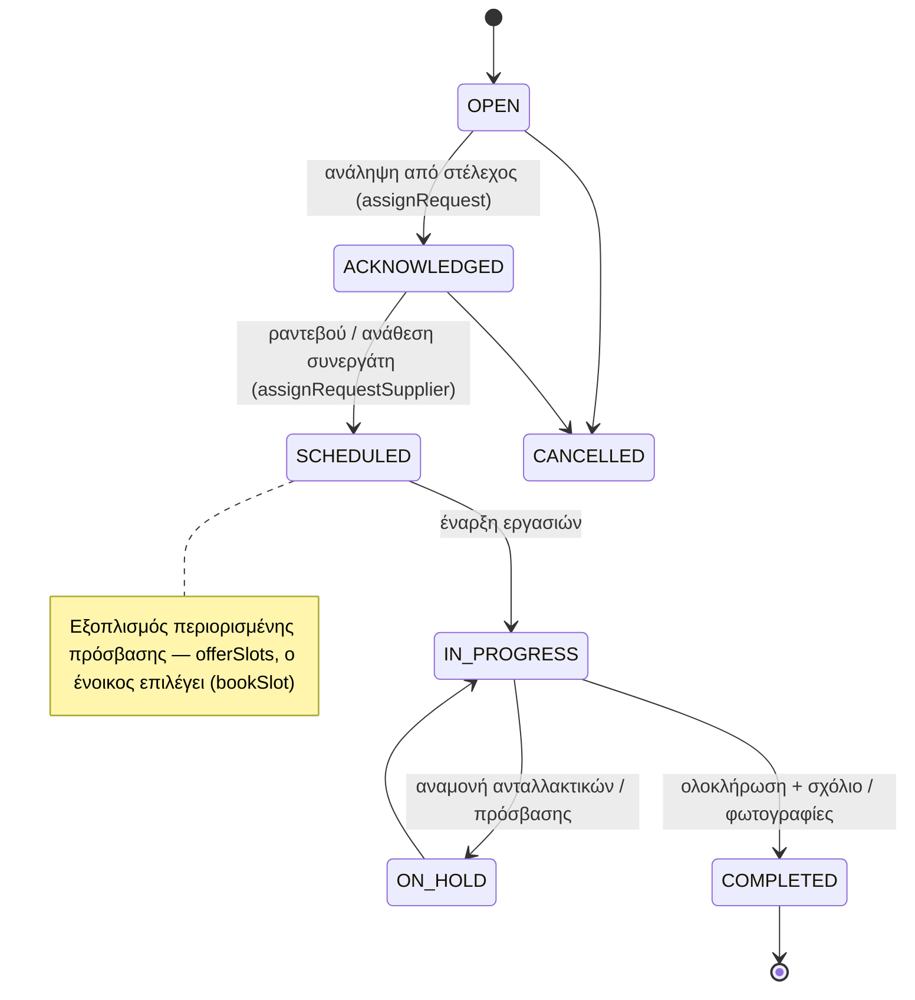

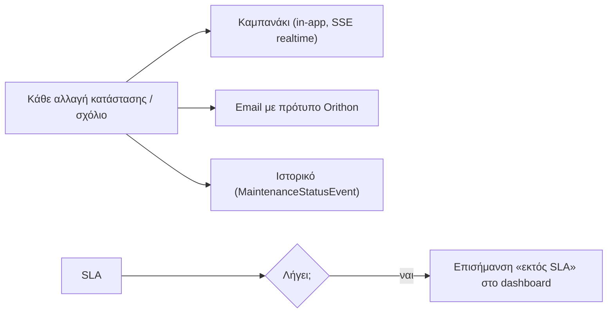

## 7. Αίτημα προσφοράς → σύμβαση έργου → παραλαβή

Back-to-back: ο συνεργάτης δίνει **τιμή συνεργάτη**, η εταιρεία προωθεί **τιμή πελάτη** (με περιθώριο), δημιουργούνται δύο συμβάσεις (Α πελάτης↔εταιρεία, Β εταιρεία↔συνεργάτης). Αναλυτικά στο [flows/suppliers.md](suppliers.md).

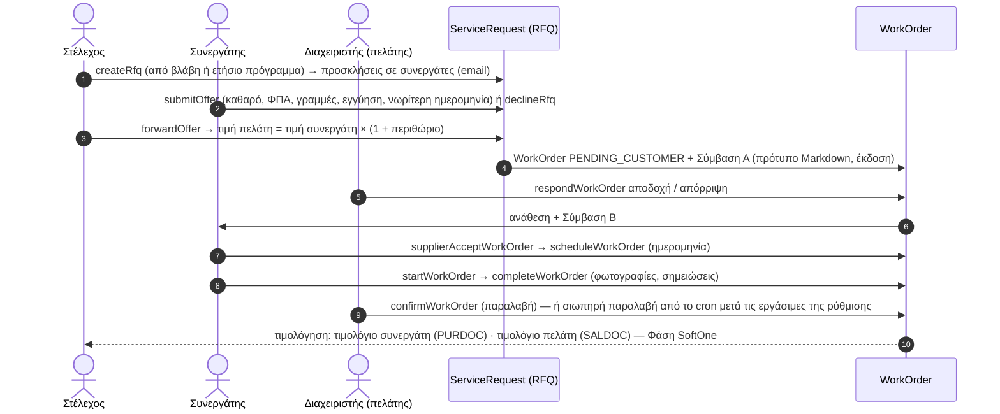

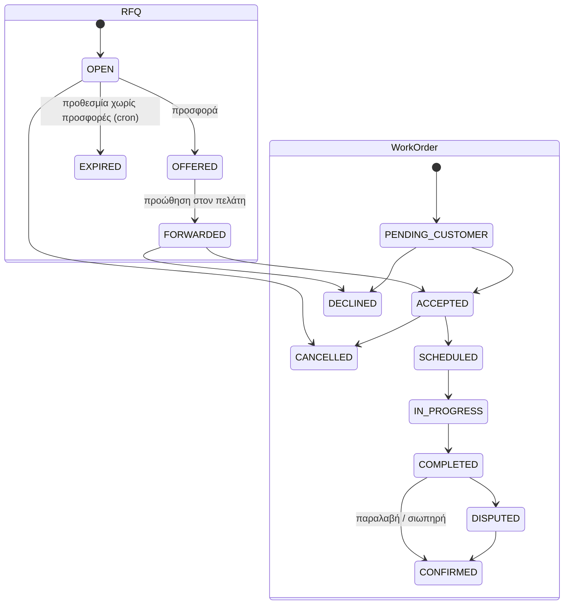

## 8. Ετήσιο πρόγραμμα συντηρήσεων και στοιχεία διαχείρισης

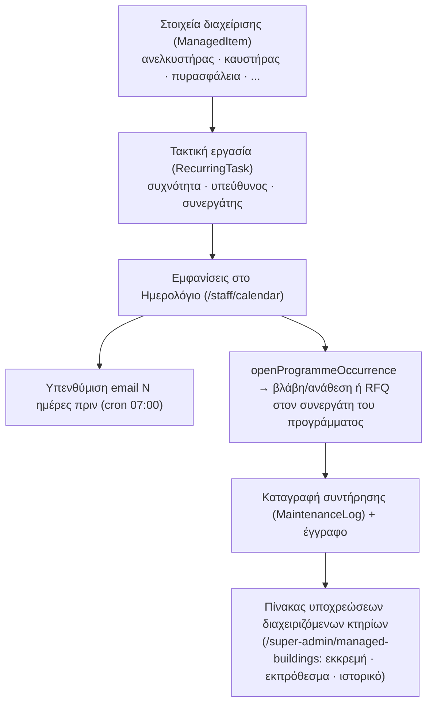

## 9. Ανακοινώσεις

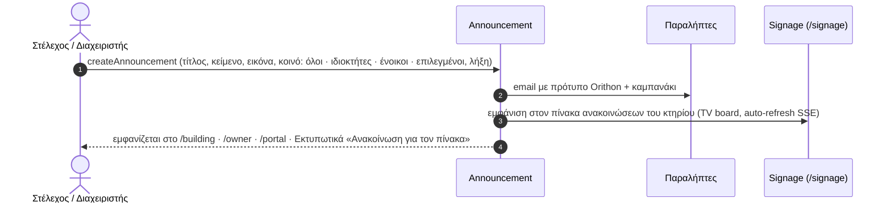

## 10. Συνελεύσεις (ηλεκτρονικές)

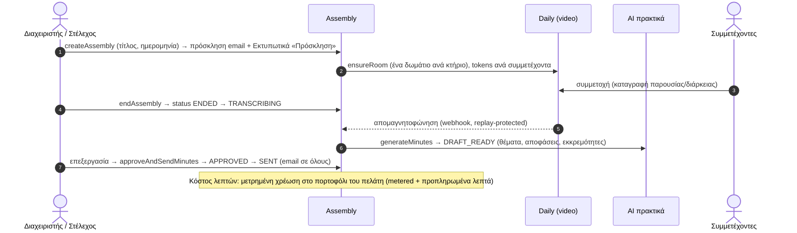

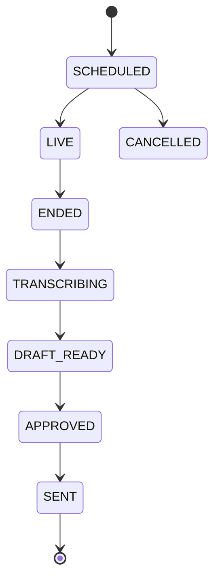

## 11. Συνεργάτες και προμηθευτές

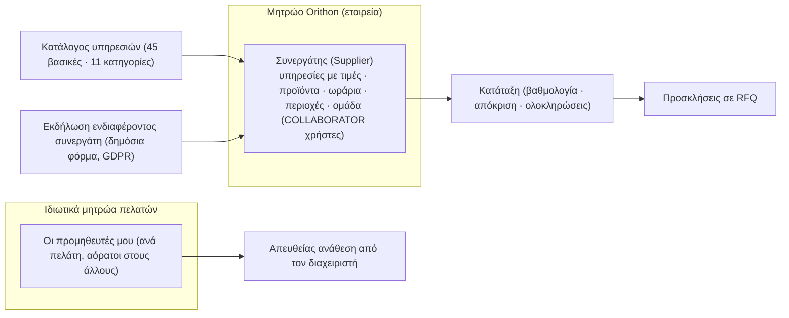

## 12. Πακέτα υπηρεσιών, τιμολόγηση και πορτοφόλια

```mermaid
flowchart TD
  SV["Υπηρεσίες (Service) · Πακέτα χρεώσεων (metered plans)"] --> PS["PropertyService: τι έχει επιλέξει κάθε ακίνητο"]
  PS --> INV["ServiceInvoice ανά μήνα (period YYYY-MM)"]
  INV --> V["Viva (λογαριασμός εταιρείας)<br/>createVivaOrder → πληρωμή → επαλήθευση"]
  V --> PAID["INVOICE PAID · απόδειξη email"]
  PS --> W["Πορτοφόλι πελάτη (Wallet)"]
  CR["Cron 1η μήνα: runMonthlyAllowance"] --> W
  W --> MT["Μετρημένη χρήση (recordMeteredUsage): λεπτά συνέλευσης, AI, κ.λπ."]
  MT --> LB{"Χαμηλό υπόλοιπο;"}
  LB -- ναι --> NT["Ειδοποίηση + προπληρωμή (addPrepaidMinutes)"]
  AIC["AI Κόστη / Tokens (πραγματικό κόστος × markup)"] --> W
```

```mermaid
sequenceDiagram
  autonumber
  actor M as Διαχειριστής
  participant PK as Ρυθμίσεις → Πακέτα
  participant V as Viva (εταιρεία)
  participant DB as Βάση
  M->>PK: επιλογή υπηρεσιών → setPropertyService
  PK->>DB: ServiceInvoice PENDING (μήνας)
  M->>V: πληρωμή
  V-->>PK: callback → επαλήθευση getVivaTransaction
  PK->>DB: INVOICE PAID · PropertyService ενεργό
```

## 13. Αρχεία και έγγραφα

```mermaid
flowchart LR
  U["Μεταφόρτωση (παραστατικά, φωτογραφίες, πιστοποιητικά, πρακτικά)"] --> R["Μετατροπή εικόνων σε WebP ≤1920px"]
  R --> C["Bunny CDN (private paths ανά κτήριο)"]
  C --> F["BuildingFile με κατηγορία · ορατότητα (δημόσια κατηγορίες → ένοικοι)"]
  F --> P["/portal/files · /owner · κέντρο ελέγχου κτηρίου"]
  E["Απόδειξη εξόδου"] --> F
  E --> S["Σύνδεσμος στο ειδοποιητήριο (οθόνη)"]
```

## 14. Εκτυπωτικά

```mermaid
flowchart LR
  H["/print (hub): κτήριο · περίοδος · φόρμα ανά έντυπο"] --> D["/print/[doc]?building&month&..."]
  D --> L["Loaders (read-only): κτήριο, μονάδες, περίοδος, κατανομές, συνελεύσεις, ανακοινώσεις"]
  L --> S["buildUnitStatement (ίδια μηχανή με τα ειδοποιητήρια οθόνης)"]
  S --> A4["Φύλλο Α4 με brand, meta, υπογραφή, αριθμό εντύπου"]
  A4 --> O["Εκτύπωση · Αποθήκευση PDF · email"]
  subgraph DOCS["9 έντυπα"]
    N["Ειδοποιητήριο (ανά διαμέρισμα)"]:::d
    SU["Συγκεντρωτική"]:::d
    EX["Ανάλυση εξόδων"]:::d
    PY["Κατάσταση πληρωμών"]:::d
    RC["Απόδειξη είσπραξης"]:::d
    PR["Πρόταση δαπάνης"]:::d
    IN["Πρόσκληση ΓΣ"]:::d
    MI["Πρακτικά"]:::d
    AN["Ανακοίνωση πίνακα"]:::d
  end
  D --> DOCS
  classDef d fill:#f1efe6,stroke:#333
```

## 15. Δημόσιο site, CMS και GDPR

```mermaid
flowchart TD
  CMS["CMS (Super Admin): Αρχική (ενότητες drag&drop) · Σελίδες · Τιμές · FAQ · Άρθρα · Συγγραφείς · Media · Μεταφράσεις (AI) · SEO · Ρυθμίσεις site"] --> SITE["Δημόσιο site el / en (next-intl, sitemap, robots, JSON-LD)"]
  SITE --> CF["Φόρμα επικοινωνίας → ContactMessage (συναίνεση, IP, ώρα)"]
  SITE --> DM["Αίτημα demo → DemoRequest (συναίνεση)"]
  SITE --> NL["Newsletter → double opt-in"]
  CF & DM & NL --> REG["Μητρώο συναινέσεων (/super-admin/cms/newsletter): εξαγωγή CSV, διαγραφή, οριστική διαγραφή"]
  SITE --> CK["Consent mode (cookies) → GA / GTM / Pixel μόνο μετά από συναίνεση"]
```

```mermaid
sequenceDiagram
  autonumber
  actor V as Επισκέπτης
  participant F as Φόρμα newsletter
  participant DB as NewsletterSubscriber
  participant E as Email
  V->>F: email + αποδοχή κειμένου συναίνεσης (έκδοση)
  F->>DB: PENDING (token, IP, ώρα, κείμενο συναίνεσης)
  F->>E: email επιβεβαίωσης με σύνδεσμο
  V->>DB: /confirm?token → CONFIRMED
  V->>DB: /unsubscribe?token (one-click σε κάθε email) → UNSUBSCRIBED (κρατείται ίχνος)
  Note over DB: «Οριστική διαγραφή» από τον Super Admin σβήνει τα δεδομένα (δικαίωμα διαγραφής)
```

## 16. Ειδοποιήσεις, email και realtime

```mermaid
flowchart LR
  EV["Γεγονός (βλάβη, προσφορά, κοινόχρηστα, ανακοίνωση, συνέλευση, cron)"] --> NT["Notification (καμπανάκι) ανά χρήστη"]
  EV --> EM["lib/email-template renderEmail: λογότυπο & στοιχεία εταιρείας (Ρυθμίσεις → Brand/Εταιρία)"]
  EM --> MG["Mailgun"]
  EM -.->|"μη-production: EMAIL_REDIRECT_TO"| RD["μία διεύθυνση δοκιμών"]
  EV --> BUS["In-process bus → /api/realtime (SSE)"]
  BUS --> UI["AutoRefresh: signage · κέντρο κτηρίου · portal · owner · καμπανάκι"]
```

## 17. Αυτόματες εργασίες (cron μέσα στην εφαρμογή)

```mermaid
flowchart TD
  ST["Εκκίνηση server (instrumentation.ts)"] --> SC["Scheduler: έλεγχος κάθε 5′ (production ή CRON_IN_PROCESS=true)"]
  SC --> D1["Καθημερινά μετά τις 07:00 (Athens)"]
  SC --> M1["1η κάθε μήνα μετά τις 06:00"]
  D1 --> J1["work-orders: σιωπηρή παραλαβή · υπενθύμιση διαχειριστή μία μέρα πριν · λήξη RFQ χωρίς προσφορές"]
  D1 --> J2["maintenance-reminders: email Ν ημέρες πριν από τακτική συντήρηση"]
  M1 --> J3["monthly-allowance: πίστωση πορτοφολιών"]
  J1 & J2 & J3 --> LOG["CronRun (ιστορικό) → Ρυθμίσεις → Αυτόματες εργασίες («Εκτέλεση τώρα»)"]
  EXT["/api/cron/* με x-cron-secret (προαιρετικός εξωτερικός trigger)"] --> J1 & J2 & J3
```

## 18. SoftOne ERP (Φάση Α/Β — προς συμφωνία)

Η διασύνδεση περιγράφεται στην [Προδιαγραφή διασύνδεσης Orithon ↔ SoftOne](../../softone/integration-spec.md) (ενότητα 5α: διαγράμματα ροών). Συνοπτικά:

```mermaid
flowchart LR
  C["Πελάτες"] -->|CUSTOMER| S1[("SoftOne")]
  S["Συνεργάτες"] -->|SUPPLIER| S1
  B["Κτήρια"] -->|PRJC| S1
  K["Κατάλογος υπηρεσιών / προϊόντα"] -->|SERVICE / ITEM| S1
  W["Σύμβαση έργου"] -->|"CNTR A + CNTR B (back-to-back)"| S1
  P["Πακέτο διαχείρισης"] -->|"CNTR περιοδική (μηνιαία)"| S1
  I["Τιμολόγια (Φάση Β)"] -->|SALDOC / PURDOC| S1
  S1 -->|"υπόλοιπα · παραστατικά (Φάση Β)"| O["Orithon"]
```

---

*Πίνακας αντιστοίχισης λειτουργίας → κώδικα:* §1 `auth.ts`, `lib/rbac/*`, `lib/impersonation.ts` · §2 `lib/ai/*`, `app/actions/building-onboarding.ts` · §3 `app/actions/{customers,properties,buildings,unit-occupants}.ts` · §4 `app/actions/building-expenses.ts`, `app/actions/koinochrista.ts`, `lib/building/statement.ts`, `lib/payments/koinochrista-pay.ts` · §5 `lib/heating-readings.ts` · §6 `app/actions/maintenance-requests.ts`, `lib/maintenance.ts` · §7 `app/actions/rfq.ts`, `lib/rfq*.ts`, `lib/contracts.ts` · §8 `app/actions/{recurring-tasks,maintenance-program,managed-items}.ts` · §9 `app/actions/announcements.ts` · §10 `app/actions/assemblies.ts`, `lib/daily.ts` · §11 `app/actions/suppliers.ts`, `lib/supplier-ranking.ts` · §12 `app/actions/property-package.ts`, `lib/wallet/*`, `lib/viva.ts` · §13 `app/actions/building-files.ts`, `lib/bunnycdn.ts` · §14 `lib/print/*` · §15 `lib/cms/*`, `lib/newsletter.ts` · §16 `lib/notify.ts`, `lib/email-template.ts`, `lib/realtime/*` · §17 `lib/cron/*` · §18 `lib/softone/*`.
