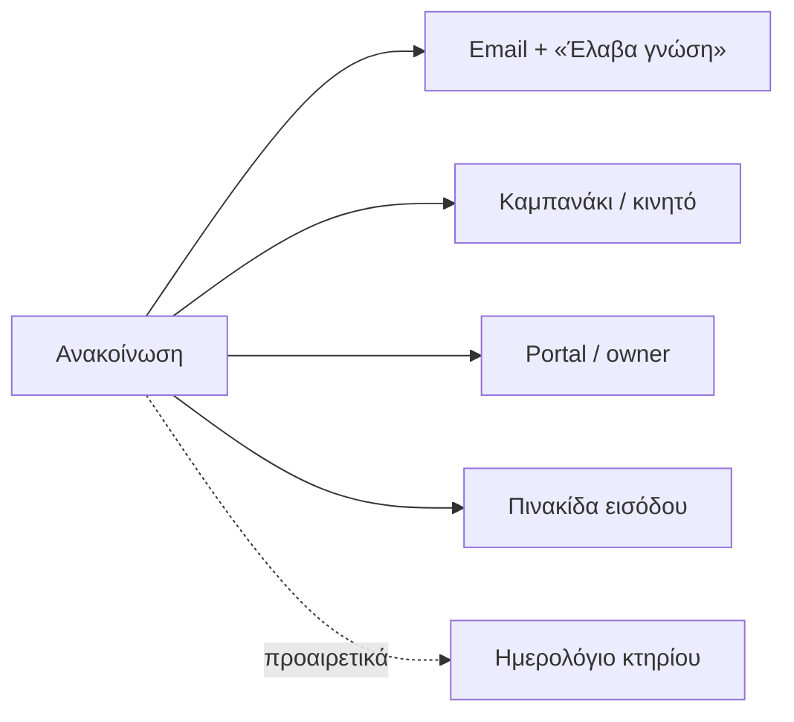

## Γιατί
Η ανακοίνωση είναι ο επίσημος τρόπος επικοινωνίας με τους ενοίκους και τους ιδιοκτήτες: φεύγει **email με σύνδεσμο «Έλαβα γνώση»**, εμφανίζεται στο **καμπανάκι** και στο κινητό, στις ανακοινώσεις του **portal/owner** και στην **πινακίδα εισόδου**. Έτσι ξέρετε ποιος την είδε — χρήσιμο για διακοπές νερού, εργασίες συνεργείων, προσκλήσεις συνέλευσης και κοινόχρηστα.

Ο **τύπος** φέρνει πρότυπο κείμενο και σωστή σήμανση (το «Επείγον» ξεχωρίζει κόκκινο, η «Συνέλευση» μπαίνει στο ημερολόγιο).

## Πριν ξεκινήσετε
- Τι θέλετε να πείτε και σε ποιους (όλοι, ιδιοκτήτες, ένοικοι, συγκεκριμένα άτομα).
- Οι παραλήπτες πρέπει να έχουν email στη μονάδα τους.

## Βήμα-βήμα
1. **Τι είδους;** Ενημέρωση, επείγον, εργασίες, συνέλευση, κοινόχρηστα — με πρότυπο κείμενο.
2. **Σε ποιους;** Όλοι, μόνο ιδιοκτήτες, μόνο ένοικοι, ή επιλεγμένα άτομα.
3. **Τι θέλετε να πείτε;** Θέμα, κείμενο, ημερομηνία, προαιρετικά και στο ημερολόγιο.
4. **Έλεγχος** και **Παράδειγμα εφαρμογής**: πώς θα το δουν, πόσοι παραλήπτες, ποια κανάλια.
5. **Δημοσίευση & αποστολή.**

## Παράδειγμα
«Διακοπή νερού αύριο 09:00–13:00», τύπος Επείγον, σε όλους: 14 παραλήπτες λαμβάνουν email με κόκκινη σήμανση, η πινακίδα της εισόδου το δείχνει, και στη λίστα ανακοινώσεων βλέπετε 11 από 14 «Έλαβα γνώση».

## Συχνές ερωτήσεις
**Μπορώ να προγραμματίσω για αργότερα;** Ναι — αλλάξτε την ημερομηνία δημοσίευσης.

**Θέλω να στείλω σε πολλά κτήρια.** Από «Ανακοινώσεις» στο μενού της εταιρείας (όχι από ένα κτήριο).

## Πού το βρίσκω μετά
Καρτέλα κτηρίου → «Ανακοινώσεις» (λίστα, ποιος έλαβε γνώση) και «Ανακοινώσεις» της εταιρείας.
