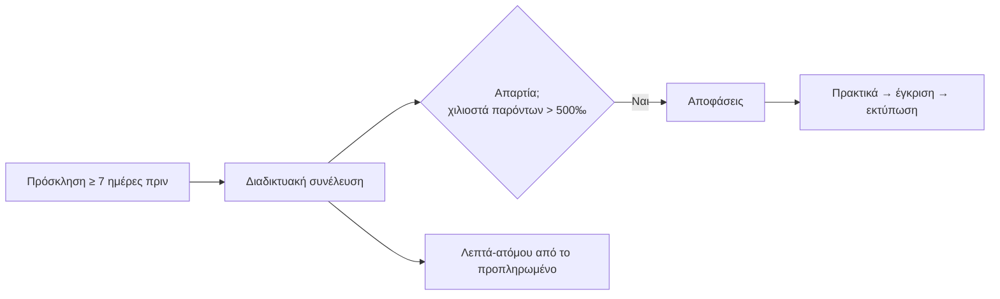

## Γιατί
Η **γενική συνέλευση** αποφασίζει για τα μεγάλα θέματα της πολυκατοικίας: απολογισμός, προϋπολογισμός, επισκευές, εκλογή διαχειριστή. Μέσα από την εφαρμογή γίνεται **διαδικτυακά**: οι συμμετέχοντες λαμβάνουν σύνδεσμο, η **απαρτία μετριέται με τα χιλιοστά** των παρόντων (πάνω από το μισό), και τα **πρακτικά γράφονται αυτόματα** από τη συζήτηση για έγκριση και εκτύπωση.

Οι συνελεύσεις χρεώνονται με **μέτρηση**: κάθε συνέλευση καταναλώνει λεπτά-ατόμου (διάρκεια × συμμετέχοντες) από το προπληρωμένο υπόλοιπο της ιδιοκτησίας (πακέτο υπηρεσιών).

## Πριν ξεκινήσετε
- Είδος (τακτική, έκτακτη, ενημερωτική), ημερομηνία και ώρα.
- Προπληρωμένο υπόλοιπο στο πακέτο της ιδιοκτησίας, αν η υπηρεσία συνελεύσεων είναι ενεργή.

## Βήμα-βήμα
1. **Τι είδους συνέλευση;** Τακτική, έκτακτη ή ενημερωτική — προτείνεται τίτλος.
2. **Πότε;** Ημερομηνία και ώρα (προτείνονται 18:00–20:30).
3. **Έλεγχος** και **Παράδειγμα εφαρμογής**: πρόσκληση → συνέλευση → απαρτία → πρακτικά, και τα λεπτά-ατόμου.
4. **Δημιουργία.** Μετά, στείλτε πρόσκληση από τις «Ανακοινώσεις» (τύπος «Συνέλευση»).

## Παράδειγμα
Τακτική ΓΣ 2026, 15/4 στις 19:00. Παρόντες οι μονάδες 2Α (500‰) και 1Β (300‰) = 800‰ → απαρτία. Διάρκεια 60′ με 10 συμμετέχοντες = 600 λεπτά-ατόμου από τα 1.800 προπληρωμένα· μένουν 1.200. Τα πρακτικά εγκρίνονται και εκτυπώνονται από τα Εκτυπωτικά.

## Συχνές ερωτήσεις
**Δεν υπάρχει προπληρωμένο υπόλοιπο.** Προσθέστε ώρες-ατόμου από το πακέτο της ιδιοκτησίας (οδηγός «Πακέτο υπηρεσιών»).

**Συμμετοχή με εξουσιοδότηση;** Ο εξουσιοδοτημένος μετρά με τα χιλιοστά της μονάδας που εκπροσωπεί.

## Πού το βρίσκω μετά
Καρτέλα κτηρίου → «Συνελεύσεις» (σύνδεσμος συμμετοχής, πρακτικά, αποφάσεις).
