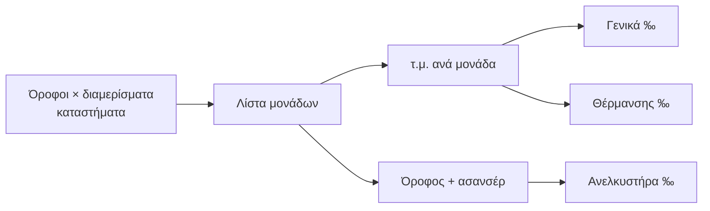

## Γιατί
Το **κτήριο** είναι η πολυκατοικία: οι **μονάδες** του (διαμερίσματα, καταστήματα, πάρκινγκ) είναι αυτές που μοιράζονται τα κοινόχρηστα, δέχονται ενοίκους και ιδιοκτήτες, και δηλώνουν βλάβες. Δύο στοιχεία καθορίζουν πώς θα μοιραστεί κάθε ευρώ:

- τα **τετραγωνικά** κάθε μονάδας → γενικά χιλιοστά (και θέρμανσης),
- ο **όροφος** → χιλιοστά ανελκυστήρα (οι ψηλότεροι όροφοι επιβαρύνονται περισσότερο).

Ο οδηγός ζητά αυτά τα στοιχεία με απλό τρόπο («3 όροφοι × 2 διαμερίσματα, 2 καταστήματα») και υπολογίζει αμέσως τα τρία σετ χιλιοστών — βάσει νόμου, χωρίς κανονισμό.

## Πριν ξεκινήσετε
- Η ιδιοκτησία πρέπει να υπάρχει (οδηγός «Νέα ιδιοκτησία»).
- Πόσοι όροφοι, πόσα διαμερίσματα ανά όροφο, καταστήματα στο ισόγειο.
- Τα τετραγωνικά (έστω κατά προσέγγιση — διορθώνονται αργότερα), αν έχει ασανσέρ, και το είδος θέρμανσης.

Προτιμάτε να το περιγράψετε με λόγια; Στο πρώτο βήμα υπάρχει το κουμπί «Περιγράψτε το στον βοηθό (AI)».

## Βήμα-βήμα
1. **Σε ποια ιδιοκτησία;** (μόνο αν δεν ξεκινήσατε από το δέντρο της).
2. **Το κτήριο.** Όνομα, διεύθυνση (προσυμπληρωμένη από την ιδιοκτησία), όροφοι, υπόγεια.
3. **Εξοπλισμός & θέρμανση.** Ανελκυστήρας (με προσαύξηση ανά όροφο, εξαίρεση ισογείου), θέρμανση (κεντρική / αυτονομία με μετρητές / ατομική), πυρασφάλεια.
4. **Οι μονάδες.** Δώστε τα βασικά, πατήστε «Δημιουργία λίστας» και διορθώστε τον πίνακα (αριθμός, όροφος, τ.μ., τύπος). Η στήλη «Γενικά ‰» ενημερώνεται ζωντανά.
5. **Έλεγχος** και **Παράδειγμα εφαρμογής**: ο πίνακας με τα τρία σετ χιλιοστών — ακριβώς αυτά που θα αποθηκευτούν.
6. **Δημιουργία.** Μετά, «Επόμενο βήμα: Χιλιοστά» για έλεγχο ή εφαρμογή κανονισμού.

## Παράδειγμα
Κτήριο με ισόγειο (2 καταστήματα των 50 τ.μ.) και 3 ορόφους × 2 διαμερίσματα των 90 τ.μ., με ασανσέρ (+10%/όροφο, ισόγειο εξαιρείται) και κεντρική θέρμανση. Ο οδηγός δημιουργεί 8 μονάδες (Κ1, Κ2, 1Α, 1Β, 2Α, 2Β, 3Α, 3Β). Σύνολο 640 τ.μ.: κάθε κατάστημα παίρνει 78,13‰ γενικά και 0‰ ανελκυστήρα· το 3Α παίρνει 140,63‰ γενικά αλλά περισσότερα ανελκυστήρα από το 1Α, γιατί μετρά 1,3× τα τετραγωνικά του.

## Συχνές ερωτήσεις
**Δεν ξέρω τα τετραγωνικά.** Αφήστε τα κενά· οι μονάδες χωρίς τ.μ. δεν παίρνουν χιλιοστά μέχρι να συμπληρωθούν από την καρτέλα του κτηρίου.

**Η πολυκατοικία έχει κανονισμό με δικά της χιλιοστά.** Δημιουργήστε το κτήριο κανονικά και μετά, στον οδηγό «Χιλιοστά», επιλέξτε «Ναι — θα δώσω τα χιλιοστά».

**Αέριο ανά διαμέρισμα;** Επιλέξτε «Ατομική»: η θέρμανση δεν μπαίνει στα κοινόχρηστα και δεν δημιουργούνται χιλιοστά θέρμανσης.

## Πού το βρίσκω μετά
Καρτέλα ιδιοκτησίας → δέντρο κτηρίων· η καρτέλα του κτηρίου (μονάδες, χιλιοστά, ένοικοι) ανοίγει με κλικ στο όνομά του.
