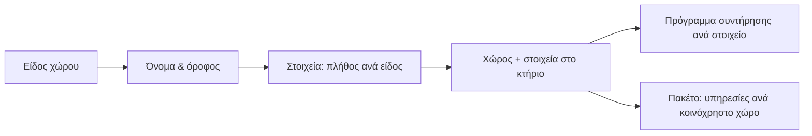

## Γιατί
Οι **κοινόχρηστοι χώροι** είναι τα μέρη του κτηρίου που ανήκουν σε όλους: κλιμακοστάσιο, είσοδος, λεβητοστάσιο, ταράτσα, αυλή. Σε κάθε χώρο η εταιρεία διαχείρισης **φροντίζει συγκεκριμένα πράγματα** — τους λαμπτήρες, τους πυροσβεστήρες, τον καυστήρα. Αυτά είναι τα **στοιχεία διαχείρισης**: από τον κατάλογο της εταιρείας, με ποσότητα και τοποθεσία, ώστε να προγραμματίζονται συντηρήσεις και να φαίνεται στους ενοίκους τι περιλαμβάνει η διαχείριση.

Οι χώροι μετρούν και στο **πακέτο**: υπηρεσίες που χρεώνονται «ανά κοινόχρηστο χώρο» αυξάνονται με κάθε νέο χώρο — ο οδηγός σας το δείχνει πριν αποθηκεύσετε.

## Πριν ξεκινήσετε
- Το κτήριο πρέπει να είναι σε ιδιοκτησία που **διαχειρίζεται η εταιρεία**.
- Ο κατάλογος «Στοιχεία Διαχείρισης» να έχει τα είδη που χρειάζεστε (λαμπτήρες, πυροσβεστήρες…).

## Βήμα-βήμα
1. **Ποιος χώρος;** Διαλέξτε είδος (κλιμακοστάσιο, είσοδος, λεβητοστάσιο…), όνομα και όροφο. Ο οδηγός προτείνει τα συνηθισμένα στοιχεία του.
2. **Τι υπάρχει εκεί;** Ποσότητα σε κάθε στοιχείο που υπάρχει στον χώρο.
3. **Έλεγχος** και **Παράδειγμα εφαρμογής**: τι θα φροντίζουμε και πώς αλλάζει η μηνιαία χρέωση.
4. **Δημιουργία χώρου.**

## Παράδειγμα
Προσθέτετε «Κλιμακοστάσιο Α» με 12 λαμπτήρες και 2 πυροσβεστήρες. Η ιδιοκτησία είχε 2 κοινόχρηστους χώρους και την υπηρεσία «Συντήρηση κοινόχρηστων χώρων» στα 15 € ανά χώρο: η χρέωση πάει από 30 € σε 45 € τον μήνα. Οι 12 λαμπτήρες εμφανίζονται στα «Στοιχεία διαχείρισης» και μπορούν να πάρουν πρόγραμμα «Αλλαγή λαμπτήρων — κάθε 6 μήνες».

## Συχνές ερωτήσεις
**Ο χώρος υπάρχει ήδη, θέλω μόνο στοιχεία.** Χρησιμοποιήστε «Προσθήκη στοιχείου» (απλή φόρμα) και επιλέξτε τον χώρο.

**Δεν βλέπω την επιλογή.** Εμφανίζεται μόνο σε κτήρια που διαχειρίζεται η εταιρεία· η δημιουργία χώρου γίνεται από τον Super Admin.

## Πού το βρίσκω μετά
Καρτέλα κτηρίου → «Διαχ. στοιχεία» (λίστα στοιχείων ανά χώρο) και μενού Ενεργειών → «Νέος κοινόχρηστος χώρος & στοιχεία».
