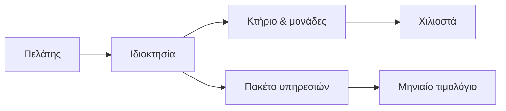

## Γιατί
Ο **πελάτης** είναι αυτός που πληρώνει την εταιρεία διαχείρισης: ένας ιδιώτης ή μια εταιρεία στην οποία ανήκουν ένα ή περισσότερα ακίνητα. Από τον πελάτη «κρέμονται» όλα τα υπόλοιπα — οι ιδιοκτησίες, τα κτήρια, οι μονάδες, το πακέτο υπηρεσιών και τα μηνιαία τιμολόγια. Χωρίς πελάτη δεν μπορεί να καταχωριστεί ακίνητο.

Ο πελάτης **δεν** είναι ο ένοικος ή ο ιδιοκτήτης ενός διαμερίσματος. Αυτοί μπαίνουν αργότερα, στις μονάδες του κτηρίου.

## Πριν ξεκινήσετε
- Το όνομα (ή την επωνυμία) του πελάτη.
- Για εταιρείες: το ΑΦΜ — τα υπόλοιπα (επωνυμία, ΔΟΥ, διεύθυνση) έρχονται αυτόματα από την ΑΑΔΕ.
- Αν θέλετε να συνδέεται στην εφαρμογή: ένα email και έναν αρχικό κωδικό.

## Βήμα-βήμα
1. **Ποιος είναι ο πελάτης;** Ιδιώτης ή εταιρεία, και το όνομά του. Ο κωδικός (C00001, C00002…) δίνεται αυτόματα.
2. **Πώς επικοινωνούμε;** Email και τηλέφωνα. Το email χρησιμεύει και για τη σύνδεση.
3. **Φορολογικά στοιχεία & έδρα.** ΑΦΜ, ΔΟΥ, διεύθυνση (με αυτόματη συμπλήρωση και στίγμα στον χάρτη).
4. **Θα συνδέεται στην εφαρμογή;** Με λογαριασμό βλέπει τα ακίνητά του, τα τιμολόγια και τα κοινόχρηστα κάθε κτηρίου.
5. **Ποιος τον αναλαμβάνει;** Ο υπεύθυνος manager της εταιρείας λαμβάνει τις ειδοποιήσεις για τα ακίνητά του.
6. **Έλεγχος** και **Παράδειγμα εφαρμογής**: τι ακολουθεί μετά τη δημιουργία.
7. **Δημιουργία πελάτη.** Στην οθόνη «Έγινε!» πατήστε «Νέα ιδιοκτησία» για να συνεχίσετε την αλυσίδα.

## Παράδειγμα
Καταχωρίζετε την «Ακίνητα Κέντρου ΑΕ» με ΑΦΜ και email `info@akinita.gr`, με λογαριασμό. Η εταιρεία παίρνει κωδικό C00012. Στη συνέχεια θα της προσθέσετε την ιδιοκτησία «Σόλωνος 12» με ένα κτήριο 8 διαμερισμάτων· το πακέτο υπηρεσιών της ιδιοκτησίας θα δώσει το πρώτο μηνιαίο τιμολόγιο. Ο εκπρόσωπος της εταιρείας συνδέεται με το `info@akinita.gr` και βλέπει τιμολόγια και κοινόχρηστα.

## Συχνές ερωτήσεις
**Μπορώ να προσθέσω πρόσβαση αργότερα;** Ναι — από την καρτέλα του πελάτη, «Πρόσκληση».

**Το ΑΦΜ δεν «περνά» τον έλεγχο.** Ο οδηγός προειδοποιεί αλλά δεν σταματά· ελέγξτε τα ψηφία ή συνεχίστε αν είστε σίγουροι.

**Έκλεισα τον οδηγό στη μέση.** Την επόμενη φορά που θα πατήσετε «Νέος Πελάτης» θα σας ρωτήσει αν θέλετε να συνεχίσετε από εκεί που μείνατε (έως 7 ημέρες).

## Πού το βρίσκω μετά
«Πελάτες» → ο νέος πελάτης στο δέντρο, με κουμπί «Προσθήκη Ιδιοκτησίας». Η καρτέλα του ανοίγει με «Προβολή».
