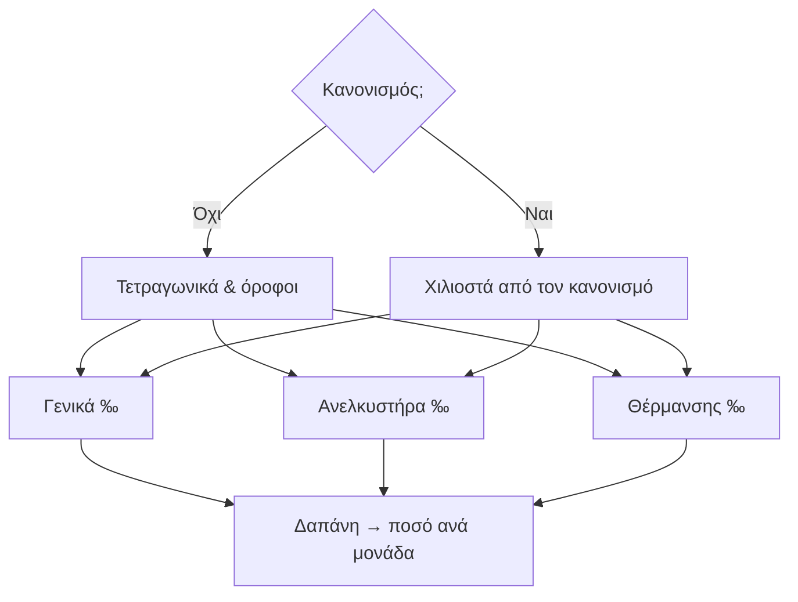

## Γιατί
Τα **χιλιοστά** είναι το ποσοστό (σε χιλιοστά του συνόλου) με το οποίο κάθε μονάδα συμμετέχει στα κοινόχρηστα. Δεν υπάρχει ένα μόνο σετ — υπάρχουν **τρία**, γιατί διαφορετικές δαπάνες μοιράζονται διαφορετικά:

| Σετ | Τι μοιράζει | Βάση υπολογισμού (χωρίς κανονισμό) | Νόμος |
|---|---|---|---|
| Γενικά | Καθαρισμός, ρεύμα κοινοχρήστων, επισκευές | Τετραγωνικά | Ν.3741/1929, ΑΚ 1002/1117 |
| Ανελκυστήρα | Συντήρηση και ρεύμα ασανσέρ | Τετραγωνικά × (1 + 10% × όροφος), ισόγειο 0 | ΚΥΑ 20.8.1997 |
| Θέρμανσης | Πετρέλαιο / αέριο κοινού λέβητα | Τετραγωνικά (ή 70% κατανάλωση + 30% χιλιοστά με μετρητές) | Ν.1512/1985, ΠΔ 27.9.1985 |

Αν η πολυκατοικία έχει **κανονισμό** με πίνακα χιλιοστών, αυτός υπερισχύει — ο οδηγός σας αφήνει να τα γράψετε.

## Πριν ξεκινήσετε
- Οι μονάδες πρέπει να έχουν τετραγωνικά και όροφο (οδηγός «Κτήριο & μονάδες»).
- Αν υπάρχει κανονισμός: ο πίνακας χιλιοστών του.

## Βήμα-βήμα
1. **Έχει κανονισμό;** Όχι → όλα υπολογίζονται· Ναι → γράφετε τα χιλιοστά (πρέπει να αθροίζουν 1000).
2. **Γενικά χιλιοστά.** Προεπισκόπηση από τα τετραγωνικά ή χειροκίνητη εισαγωγή.
3. **Ανελκυστήρας.** Υπάρχει; Προσαύξηση ανά όροφο, εξαίρεση ισογείου.
4. **Θέρμανση.** Κεντρική κατά χιλιοστά, αυτονομία με μετρητές (70/30), ίσα ανά μονάδα, ή ατομική (τίποτα στα κοινόχρηστα).
5. **Έλεγχος** και **Παράδειγμα εφαρμογής**: τρεις δαπάνες (καθαρισμός 1.000 €, ανελκυστήρας 600 €, πετρέλαιο 2.000 €) και τι πληρώνει κάθε μονάδα.
6. **Εφαρμογή χιλιοστών.**

## Παράδειγμα
Τρεις μονάδες: Κ1 (ισόγειο, 50 τ.μ.), 1Α (100 τ.μ.), 2Α (100 τ.μ.). Γενικά: 200‰ / 400‰ / 400‰. Καθαρισμός 1.000 € → 200 € / 400 € / 400 €. Ανελκυστήρας με εξαίρεση ισογείου: το Κ1 πληρώνει 0 € από τα 600 €, το 2Α περισσότερο από το 1Α γιατί μετρά 1,2× τα τετραγωνικά του.

## Συχνές ερωτήσεις
**Τα χιλιοστά του κανονισμού δεν αθροίζουν 1000.** Ο οδηγός δείχνει πόσα λείπουν ή περισσεύουν και δεν προχωρά — ελέγξτε τον πίνακα.

**Μία μονάδα χωρίς τετραγωνικά.** Δεν παίρνει χιλιοστά (δεν πληρώνει) μέχρι να συμπληρωθούν· οι υπόλοιπες μοιράζονται το 1000.

**Μπορώ να αλλάξω ένα κελί αργότερα;** Ναι — «Χιλιοστά ανά μονάδα» στο μενού Ενεργειών του κτηρίου· ένα χειροκίνητο κελί κλειδώνει (δεν ξαναϋπολογίζεται).

## Πού το βρίσκω μετά
Καρτέλα κτηρίου → Ενέργειες → «Χιλιοστά βήμα-βήμα» ή «Χιλιοστά ανά μονάδα». Τα ειδοποιητήρια κοινοχρήστων δείχνουν το σετ και τη νομική βάση κάθε δαπάνης.
