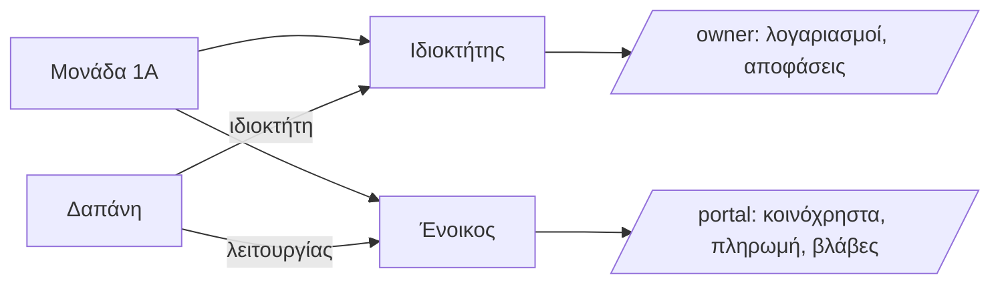

## Γιατί
Κάθε μονάδα έχει έναν **ιδιοκτήτη** και, αν ενοικιάζεται, έναν **ένοικο**. Τα κοινόχρηστα κάθε μονάδας **μοιράζονται αυτόματα ανάμεσά τους**: οι δαπάνες λειτουργίας (καθαρισμός, ρεύμα, πετρέλαιο) στον ένοικο, οι δαπάνες ιδιοκτήτη (επισκευές, μόνωση, ανελκυστήρας-επισκευή) στον ιδιοκτήτη — τα ποσοστά ορίζονται ανά κατηγορία δαπάνης. Με λογαριασμό, το πρόσωπο βλέπει τα δικά του κοινόχρηστα, πληρώνει online και δηλώνει βλάβες από το κινητό.

Η **ημερομηνία έναρξης** καθορίζει από ποιον μήνα χρεώνεται το νέο πρόσωπο· ο προηγούμενος κλείνει αυτόματα την ίδια μέρα — έτσι το ιστορικό χρεώσεων μένει σωστό σε κάθε αλλαγή ενοίκου.

## Πριν ξεκινήσετε
- Ποια μονάδα, και αν ορίζετε ιδιοκτήτη ή ένοικο.
- Το όνομα και το email του προσώπου· για νέο λογαριασμό έναν αρχικό κωδικό.

## Βήμα-βήμα
1. **Τι θέλετε να ορίσετε;** Ιδιοκτήτη ή ένοικο.
2. **Ποιος είναι;** Υπάρχον πρόσωπο (αναζήτηση με όνομα/email — αν π.χ. είναι ιδιοκτήτης και αλλού) ή νέο (ιδιώτης ή εταιρεία).
3. **Από πότε;** Σήμερα ή άλλη ημερομηνία (π.χ. έναρξη μισθωτηρίου).
4. **Έλεγχος** και **Παράδειγμα εφαρμογής**: τι θα βλέπει και ποιες δαπάνες πληρώνει.
5. **Καταχώρηση.**

## Παράδειγμα
Στη μονάδα 1Α ορίζετε ένοικο τη Μαρία από 1/3. Από τον Μάρτιο, τα 100 € καθαρισμού της μονάδας χρεώνονται στη Μαρία· τα 300 € επισκευής ανελκυστήρα στον ιδιοκτήτη. Η Μαρία συνδέεται στο portal, βλέπει το ειδοποιητήριο και πληρώνει με Viva.

## Συχνές ερωτήσεις
**Το ίδιο πρόσωπο σε δύο μονάδες;** Ναι — επιλέξτε «Υπάρχον πρόσωπο»· θα δει και τις δύο.

**Η μονάδα είναι ιδιοκατοίκηση.** Ορίστε μόνο ιδιοκτήτη· όλα τα κοινόχρηστα χρεώνονται σε αυτόν.

## Πού το βρίσκω μετά
Καρτέλα κτηρίου → «Μονάδες» (ιδιοκτήτης/ένοικος ανά μονάδα) και «Άνθρωποι» (καρτέλα προσώπου με χρεώσεις και πληρωμές).
