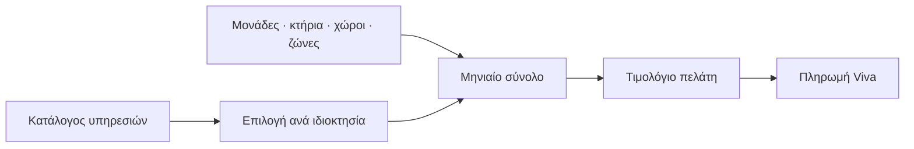

## Γιατί
Το **πακέτο** είναι οι υπηρεσίες του καταλόγου που έχει επιλέξει ο πελάτης για μια ιδιοκτησία. Από αυτό προκύπτει **αυτόματα το μηνιαίο τιμολόγιο**: κάθε υπηρεσία μετρά κάτι (μονάδες, κτήρια, κοινόχρηστους χώρους, ζώνη απόστασης) και το ποσό ακολουθεί τα πραγματικά νούμερα της ιδιοκτησίας. Η **βασική υπηρεσία (CORE)** είναι πάντα μέσα· οι υπόλοιπες ενεργοποιούνται ανά ιδιοκτησία — δύο ιδιοκτησίες του ίδιου πελάτη μπορούν να έχουν διαφορετικά πακέτα.

Οι **γενικές συνελεύσεις** χρεώνονται με μέτρηση: ο πελάτης **προαγοράζει ώρες-ατόμου** (διάρκεια × συμμετέχοντες) που καταναλώνονται σε κάθε συνέλευση.

## Πριν ξεκινήσετε
- Η ιδιοκτησία με τα κτήρια και τις μονάδες της (οι ποσότητες μετρούνται ζωντανά).
- Οι υπηρεσίες στον κατάλογο («Υπηρεσίες»).

## Βήμα-βήμα
1. **Τι περιλαμβάνει;** Λίστα υπηρεσιών με ζωντανό ποσό ανά υπηρεσία και μηνιαίο σύνολο· η βασική είναι κλειδωμένη.
2. **Συνελεύσεις** (αν υπάρχει υπηρεσία με μέτρηση): ώρες-ατόμου προς προαγορά — προαιρετικά.
3. **Έλεγχος** και **Παράδειγμα εφαρμογής**: το τιμολόγιο της περιόδου, γραμμή-γραμμή.
4. **Αποθήκευση πακέτου.**

## Παράδειγμα
Ιδιοκτησία με 12 μονάδες, 2 κτήρια, 4 κοινόχρηστους χώρους. Βασική διαχείριση 3 €/μονάδα → 36 €· καθαρισμός 15 €/χώρο → 60 €· συνελεύσεις με μέτρηση → 0 € συν προαγορά 10 ωρών-ατόμου. Μηνιαίο σύνολο 96 €. Μια συνέλευση 60′ με 10 άτομα καταναλώνει 10 ώρες-ατόμου.

## Συχνές ερωτήσεις
**Άλλαξα το πακέτο στη μέση του μήνα.** Το τιμολόγιο της τρέχουσας περιόδου, αν έχει ήδη εκδοθεί, δεν αλλάζει· οι αλλαγές ισχύουν από την επόμενη.

**Γιατί η χρέωση ανά ζώνη δείχνει «χωρίς απόσταση»;** Ένα κτήριο δεν έχει στίγμα — προσθέστε τη διεύθυνση με αυτόματη συμπλήρωση και η απόσταση θα υπολογιστεί.

## Πού το βρίσκω μετά
Καρτέλα ιδιοκτησίας → «Πακέτο Υπηρεσιών» (toggles ανά υπηρεσία, υπόλοιπο προαγοράς, πληρωμή).
