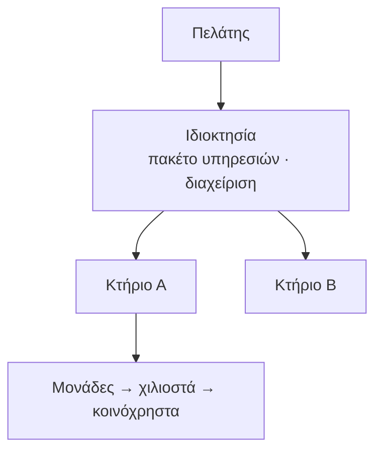

## Γιατί
Η **ιδιοκτησία** είναι το ακίνητο ενός πελάτη: μια πολυκατοικία, ή ένα συγκρότημα με περισσότερα κτήρια. Είναι το επίπεδο όπου ορίζεται **το πακέτο υπηρεσιών** και άρα η μηνιαία χρέωση του πελάτη — όχι ανά κτήριο. Κάθε ιδιοκτησία ξεκινά αυτόματα με ένα πρώτο κτήριο, ώστε να μπορείτε αμέσως να προσθέσετε μονάδες.

Η ιδιοκτησία καθορίζει επίσης αν **τη διαχειρίζεται η εταιρεία** (διαχειριστής = υπάλληλος, στοιχεία διαχείρισης, συντηρήσεις) ή αν είναι **αυτοδιαχείριστη** (διαχειριστής = ιδιοκτήτης/ένοικος/πελάτης, η εταιρεία παρέχει μόνο το πακέτο).

## Πριν ξεκινήσετε
- Ο πελάτης πρέπει να υπάρχει (οδηγός «Νέος πελάτης»).
- Η διεύθυνση — με την αυτόματη συμπλήρωση βρίσκεται και το στίγμα, που χρειάζεται για τις χρεώσεις απόστασης.

## Βήμα-βήμα
1. **Για ποιον πελάτη;** (μόνο αν δεν ξεκινήσατε από την καρτέλα του).
2. **Όνομα & διεύθυνση.** Συνήθως το όνομα είναι η διεύθυνση.
3. **Ποιος τη διαχειρίζεται;** Εταιρεία ή αυτοδιαχείριση.
4. **Το πρώτο κτήριο.** Ίδια διεύθυνση με την ιδιοκτησία (συνήθως) ή άλλη.
5. **Έλεγχος** και **Παράδειγμα εφαρμογής**: το δέντρο Πελάτης › Ιδιοκτησία › Κτήριο.
6. **Δημιουργία.** Μετά, «Επόμενο βήμα: Νέο κτήριο με τις μονάδες του».

## Παράδειγμα
Η «Ακίνητα Κέντρου ΑΕ» αποκτά την ιδιοκτησία «Σόλωνος 12», διαχειριζόμενη από την εταιρεία, με πρώτο κτήριο στην ίδια διεύθυνση. Στο επόμενο βήμα το κτήριο παίρνει 8 διαμερίσματα και 2 καταστήματα· το πακέτο (π.χ. βασική διαχείριση ανά μονάδα) χρεώνεται στην ιδιοκτησία και εμφανίζεται στο μηνιαίο τιμολόγιο του πελάτη.

## Συχνές ερωτήσεις
**Μία ιδιοκτησία, πολλά κτήρια;** Ναι — προσθέστε κτήρια από την καρτέλα της ιδιοκτησίας· το πακέτο μετρά τις μονάδες όλων των κτηρίων.

**Μπορώ να αλλάξω «αυτοδιαχείριση» αργότερα;** Ναι, από την επεξεργασία της ιδιοκτησίας.

## Πού το βρίσκω μετά
«Ιδιοκτησίες» → η νέα ιδιοκτησία με το κτήριό της· «Διαχείριση» ανοίγει την καρτέλα με το πακέτο υπηρεσιών.
