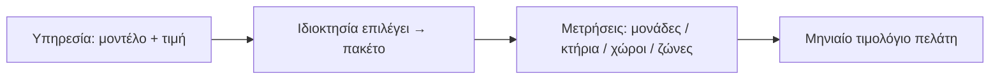

## Γιατί
Ο **κατάλογος υπηρεσιών** είναι ό,τι πουλά η εταιρεία: βασική διαχείριση, καθαρισμοί, συνελεύσεις, τεχνική υποστήριξη. Κάθε υπηρεσία έχει ένα **μοντέλο τιμολόγησης** — τι μετράμε κάθε μήνα — και μια τιμή. Οι ιδιοκτησίες επιλέγουν υπηρεσίες από τον κατάλογο (το «πακέτο» τους) και από αυτές προκύπτει αυτόματα το μηνιαίο τιμολόγιο του πελάτη. Δεν χρειάζεται κώδικας για νέα υπηρεσία: την περιγράφετε εδώ.

| Μοντέλο | Τι μετρά | Παράδειγμα |
|---|---|---|
| Ανά μονάδα / μήνα | Διαμερίσματα + καταστήματα | Βασική διαχείριση 3 € × 12 μονάδες = 36 € |
| Ανά κτήριο / μήνα | Κτήρια της ιδιοκτησίας | Έλεγχος εγκαταστάσεων 40 € × 2 κτήρια |
| Ανά κοινόχρηστο χώρο / μήνα | Κλιμακοστάσια, είσοδοι… | Καθαρισμός 15 € × 4 χώροι |
| Σταθερή / μήνα | Ένα ποσό ανά ιδιοκτησία | Λογιστική υποστήριξη 50 € |
| Με μέτρηση + προαγορά | Λεπτά συμμετοχής σε συνελεύσεις | 60′ × 10 άτομα = 600 λεπτά από το υπόλοιπο |
| Ανά ζώνη απόστασης | Βασική + ποσό ανά κτήριο κατά ζώνη | 10 € + Ζώνη Β 12 € για ένα μακρινό κτήριο |

## Πριν ξεκινήσετε
- Το όνομα και την τιμή. Ο κωδικός προτείνεται αυτόματα (λατινικά κεφαλαία, ταιριάζει με τη SoftOne).
- Για χρέωση ανά ζώνη: οι ζώνες από Ρυθμίσεις → Σταθμός βάσης & ζώνες.

## Βήμα-βήμα
1. **Τι υπηρεσία;** Όνομα, κωδικός, περιγραφή, βασική (CORE) ή πρόσθετη (module).
2. **Πώς χρεώνεται;** Ένα από τα έξι μοντέλα με επεξήγηση, η τιμή, και για ζώνες ο πίνακας ανά ζώνη.
3. **Έλεγχος** και **Παράδειγμα εφαρμογής**: τι θα χρεώσει σε μια μικρή πολυκατοικία (5 μονάδες) και σε ένα συγκρότημα (12 μονάδες, 2 κτήρια).
4. **Δημιουργία υπηρεσίας.**

## Παράδειγμα
«Καθαρισμός κοινοχρήστων», ανά κοινόχρηστο χώρο, 15 €. Μικρή πολυκατοικία με 2 χώρους → 30 € τον μήνα· συγκρότημα με 4 χώρους → 60 €. Αν αργότερα προστεθεί τρίτος χώρος στη μικρή, η χρέωση γίνεται 45 € — το δείχνει ο οδηγός «Κοινόχρηστος χώρος».

## Συχνές ερωτήσεις
**Τι είναι CORE;** Η βασική υπηρεσία που είναι πάντα ενεργή σε κάθε ιδιοκτησία — δεν αφαιρείται από το πακέτο.

**Μπορώ να αλλάξω τιμή;** Ναι, από τη λίστα υπηρεσιών (επεξεργασία). Ισχύει από το επόμενο τιμολόγιο.

## Πού το βρίσκω μετά
«Υπηρεσίες» (κατάλογος) και στην καρτέλα κάθε ιδιοκτησίας → «Πακέτο».
