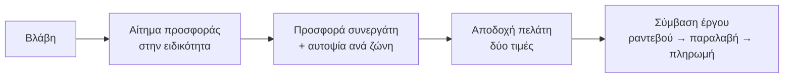

## Γιατί
Οι **συνεργάτες** (συνεργεία και προμηθευτές) είναι αυτοί που εκτελούν τις εργασίες στα κτήρια. Με **ειδικότητες** (κατηγορίες βλαβών) προτείνονται αυτόματα στις σωστές βλάβες· με **έδρα** υπολογίζεται η απόσταση ως κάθε κτήριο και η **προσαύξηση αυτοψίας ανά ζώνη**· με **έκτακτα 24/7** έρχονται πρώτοι στα επείγοντα.

Η αλυσίδα: ένας ένοικος δηλώνει βλάβη → η εταιρεία στέλνει **αίτημα προσφοράς** στους συνεργάτες της ειδικότητας (με σύνδεσμο, χωρίς λογαριασμό) → ο συνεργάτης δίνει **προσφορά** → ο πελάτης αποδέχεται → δημιουργείται **σύμβαση έργου** back-to-back με δύο τιμές (συνεργάτη και πελάτη) → ραντεβού, εκτέλεση, παραλαβή, πληρωμή, αξιολόγηση.

## Πριν ξεκινήσετε
- Επωνυμία, ΑΦΜ, τηλέφωνο, email.
- Τις ειδικότητές του (κατηγορίες βλαβών) και αν χρεώνει αυτοψία.
- Για προσαύξηση ανά ζώνη: οι ζώνες από Ρυθμίσεις → Σταθμός βάσης & ζώνες.

## Βήμα-βήμα
1. **Τι κάνει;** Συνεργείο / προμηθευτής / και τα δύο, ειδικότητες, έκτακτα 24/7.
2. **Ποιος είναι;** Επωνυμία, ΑΦΜ/ΔΟΥ, επικοινωνία, υπεύθυνος.
3. **Από πού ξεκινά;** Έδρα (με στίγμα), αυτοψία δωρεάν ή με χρέωση (+ προσαύξηση ανά ζώνη, συμψηφισμός), πίστωση.
4. **Έλεγχος** και **Παράδειγμα εφαρμογής**: η χρονογραμμή από τη βλάβη ως τη σύμβαση και ο πίνακας αυτοψίας ανά ζώνη.
5. **Καταχώριση.** Μετά, «Άνοιγμα καρτέλας & πρόσκληση χρήστη» για πρόσβαση στο marketplace.

## Παράδειγμα
«Ηλεκτρολογικές Εργασίες Παπαδόπουλος», ειδικότητα Ηλεκτρολογικά, αυτοψία 30 € που συμψηφίζεται, προσαύξηση Ζώνη Β +12 €. Βλάβη σε πίνακα ρεύματος σε κτήριο της Ζώνης Β: η προσφορά προσυμπληρώνει αυτοψία 42 €· αν ο πελάτης αναθέσει την εργασία, η αυτοψία δεν χρεώνεται.

## Συχνές ερωτήσεις
**Ο συνεργάτης θέλει πρόσβαση στην εφαρμογή.** Από την καρτέλα του → Επαφές → πρόσκληση· συνδέεται στο marketplace και απαντά σε αιτήματα από εκεί.

**Δεν βλέπω ειδικότητες.** Οι κατηγορίες βλαβών ορίζονται στις Ρυθμίσεις συντηρήσεων.

## Πού το βρίσκω μετά
«Συνεργάτες & Προμηθευτές» → καρτέλα συνεργάτη (επαφές, κατάλογος τιμών, ωράριο, αξιολογήσεις).
