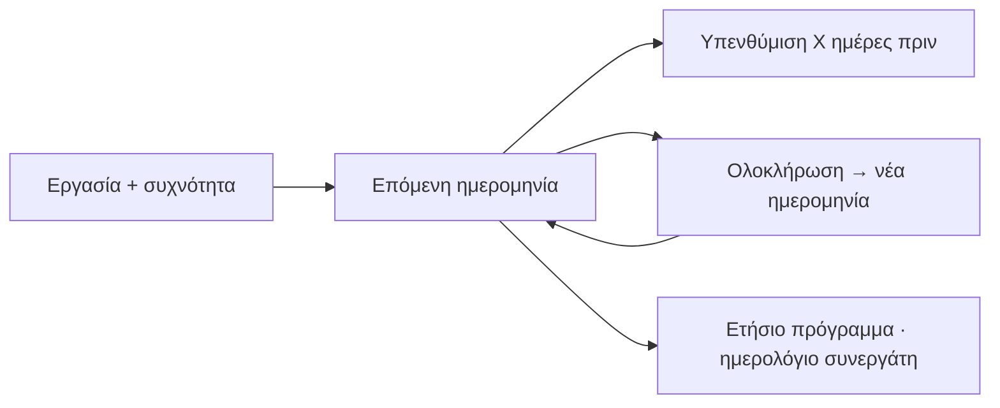

## Γιατί
Ορισμένες εργασίες **επαναλαμβάνονται** και μερικές είναι **υποχρεωτικές**: μηνιαία συντήρηση ανελκυστήρα, ετήσιος έλεγχος καυστήρα, πυρασφάλεια. Στο ημερολόγιο του κτηρίου κάθε τέτοια εργασία έχει συχνότητα και επόμενη ημερομηνία· μετά από κάθε «Ολοκλήρωση» η επόμενη υπολογίζεται μόνη της, και **πριν από κάθε φορά** έρχεται υπενθύμιση με email και στο καμπανάκι. Το ετήσιο πρόγραμμα της εταιρείας και το ημερολόγιο των συνεργατών τροφοδοτούνται από εδώ.

**Εντός πακέτου** σημαίνει ότι την αναλαμβάνει η εταιρεία χωρίς επιπλέον χρέωση· εκτός πακέτου, η δαπάνη καταχωρίζεται στα έξοδα του κτηρίου.

## Πριν ξεκινήσετε
- Τι συντηρείται και κάθε πότε.
- Αν ξέρετε, την επόμενη ημερομηνία και τον ανάδοχο (συνεργάτης ή ελεύθερο όνομα).

## Βήμα-βήμα
1. **Τι θέλετε να συντηρείται;** Κατηγορία (προτείνει όνομα και συχνότητα).
2. **Κάθε πότε;** Εβδομάδα, μήνα, τρίμηνο, εξάμηνο, χρόνο — και η επόμενη φορά.
3. **Ποιος την αναλαμβάνει;** Συνεργάτης από τη λίστα ή όνομα συνεργείου· εντός ή εκτός πακέτου.
4. **Πότε να σας θυμίζουμε;** 3 ημέρες έως 1 μήνα πριν.
5. **Έλεγχος** και **Παράδειγμα εφαρμογής**: οι επόμενες 3 ημερομηνίες με τις υπενθυμίσεις τους.
6. **Αποθήκευση στο ημερολόγιο.**

## Παράδειγμα
«Συντήρηση ανελκυστήρα», κάθε μήνα, επόμενη 10/3, ανάδοχος KLEEMANN, υπενθύμιση 7 ημέρες πριν. Το ημερολόγιο δείχνει 10/3, 10/4, 10/5 με υπενθυμίσεις 3/3, 3/4, 3/5. Είναι εντός πακέτου — καμία χρέωση στον πελάτη.

## Συχνές ερωτήσεις
**Δεν ξέρω την ακριβή ημερομηνία.** Βάλτε εκτίμηση — θα λάβετε υπενθύμιση και θα τη διορθώσετε.

**Η εργασία αφορά συγκεκριμένο στοιχείο (π.χ. λαμπτήρες κλιμακοστασίου).** Ορίστε το πρόγραμμα από τα «Στοιχεία διαχείρισης» του κτηρίου ώστε να συνδέεται με το στοιχείο.

## Πού το βρίσκω μετά
Καρτέλα κτηρίου → «Συντηρήσεις» / ημερολόγιο· «Ετήσιο πρόγραμμα» για όλα τα κτήρια.
